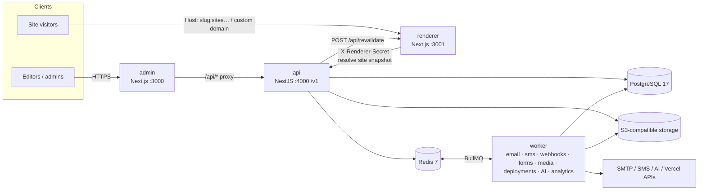

# Atrium

Atrium is a multi-tenant, schema-driven, AI-native website builder. Organizations design websites in a
visual builder (or let an AI agent draft them), publish immutable versions, and serve them from a shared
renderer on platform subdomains or custom domains, or deploy each site independently to Vercel and other
hosts.

- **Schema-driven.** A site is data. Pages are trees of components defined in a registry (props schema,
  inspector controls, variants, AI hints). The builder, API, renderer and AI agent all read the same
  definitions.
- **AI is another builder operator.** The agent edits sites only through the same validated `SiteOperation`s
  people use. Permissions are checked on every operation, changes are versioned, and every change can be
  reverted.
- **Provider-independent.** Storage (S3, R2, MinIO, SeaweedFS, Oracle, Azure Blob, local disk), email
  (SMTP presets, Resend, Mailgun, SendGrid, Postmark), SMS (Twilio, Vonage, SNS, HTTP, Sparrow, Aakash), AI
  (Anthropic, OpenAI, Gemini), deployment (Vercel, Netlify, Cloudflare Pages, self-hosted) and captcha
  (reCAPTCHA v2/v3, Turnstile, hCaptcha) are pluggable drivers. Organizations can bring their own credentials,
  which are encrypted with AES-256-GCM.

## Features

| Area | What you get |
|---|---|
| Builder | Drag-and-drop sections, inspector controls generated from the registry, responsive styles, theme tokens, GSAP animation presets, global sections, autosave with optimistic concurrency, page versions |
| Publishing | Validation report, immutable site snapshots, ISR revalidation, preview links (expiring, optional password), rollback to any version |
| AI | Generate a site from a brief, edit or generate pages and sections, rewrite text, suggest SEO; changes are shown as proposals, applied as one version, and can be reverted |
| CMS | Collections with typed fields, items bound into list components, collection page templates |
| Forms | Form builder, conditional rules and workflows (email, SMS, webhook), captcha + honeypot + spam scoring, submissions inbox, CSV/XLSX export |
| Media | Library with folders, de-duplication, responsive variants and blur placeholders (sharp), signed URLs |
| Domains | Platform subdomains, custom domains with DNS guidance and verification, automatic TLS |
| Teams | Organizations, workspaces, custom roles built from permission keys, per-website access, invitations, MFA, audit log |
| Operations | Webhooks with HMAC signatures, privacy-preserving analytics, super-admin console, BullMQ job monitoring |
| Ops tooling | The `atrium` CLI (bench-style), Podman/Docker images, Kubernetes manifests, deployment guides for 12 targets |

## Architecture



See [docs/ARCHITECTURE.md](docs/ARCHITECTURE.md) for the publishing, AI, forms, media, authentication,
rendering and Vercel deployment flows.

## Quick start (Podman)

Prerequisites: Node.js 24 (22.12 or newer), pnpm 10, Podman with `podman compose` (or Docker), and git.
On macOS: `brew install podman podman-compose && podman machine init --memory 6144 && podman machine start`.
See [docs/deployment/local-podman.md](docs/deployment/local-podman.md) for setup and troubleshooting.

```bash
pnpm install
pnpm atrium init          # .env with generated secrets, free ports, podman services, migrations, seed
pnpm atrium start         # api, worker, renderer, admin with prefixed logs (Ctrl+C stops all)
```

Manual equivalent:

```bash
cp .env.example .env                                   # then replace the change-me secrets (atrium setup env does this)
podman compose -f infra/compose.yaml up -d             # postgres, redis, s3 (SeaweedFS), mailpit
pnpm install
pnpm build                                             # workspace packages (Prisma client, schema, registry…)
pnpm db:deploy && pnpm db:seed
pnpm dev
```

### URLs and ports

| Service | URL | Notes |
|---|---|---|
| Admin + builder | http://localhost:3000 | sign in with the seeded super-admin |
| API | http://localhost:4000/v1 | health: `/v1/health`, readiness: `/v1/health/ready`; reference: [docs/API.md](docs/API.md) |
| Public sites | http://&lt;slug&gt;.sites.localhost:3001 | browsers resolve `*.localhost` to 127.0.0.1 |
| Mailpit (captured email) | http://localhost:58025 | SMTP on 51025 |
| PostgreSQL | localhost:55432 | user/password/db `atrium` |
| Redis | localhost:56379 | |
| S3 (SeaweedFS) | http://localhost:59000 | bucket `atrium-media`, keys `atrium` / `atrium-secret` |

Host ports use the 5xxxx range so they do not collide with other local stacks on 5432, 1025 or 8025.
`atrium init` picks free ports automatically when defaults are taken.

**Demo credentials.** The seed creates a super-admin from `SEED_ADMIN_EMAIL` (default
`admin@atrium.localhost`) and `SEED_ADMIN_PASSWORD` in `.env`. Show it with
`pnpm atrium config get SEED_ADMIN_PASSWORD --reveal`, or change it with `pnpm atrium set-admin-password`.
`pnpm atrium seed --demo` adds a demo organization with sample websites.

## CLI cheat sheet

The `atrium` CLI (`pnpm atrium …`) is modelled on Frappe's `bench`. The full reference, including a
bench-to-atrium command map, is in [docs/CLI.md](docs/CLI.md).

| Task | Command |
|---|---|
| Set up a dev environment | `atrium init` |
| Run everything / a subset / in the background | `atrium start` · `atrium start --only api,worker` · `atrium start -d` |
| Health of infra, apps, queues, migrations | `atrium status` · `atrium doctor` |
| Logs | `atrium logs postgres -f` · `atrium logs api` |
| Database | `atrium migrate` · `atrium migrate --dev --name add_x` · `atrium seed --demo` · `atrium db console` · `atrium console` |
| Settings in `.env` (secrets masked) | `atrium config list` · `atrium config set KEY value` · `atrium config set KEY --generate` |
| Sites | `atrium login` · `atrium new-site "Acme" --template <key>` · `atrium list-sites` · `atrium use acme` · `atrium publish` · `atrium export-site --format nextjs` |
| Users and organizations | `atrium create-user --email … --name … --super-admin` · `atrium new-org Acme --owner me@acme.com` |
| Backups | `atrium backup --with-files --keep 7` · `atrium restore latest --force` |
| Production files | `atrium setup production --target podman\|docker\|systemd\|k8s\|cpanel\|aws\|azure\|gcp\|vercel\|fly\|railway\|render --domain example.com` |
| Upgrade | `atrium update` (backup, pull, install, migrate, build) |
| Extend | `atrium new-component pricing-table` · `atrium new-provider email brevo` · `atrium new-plugin hotel-kit` |

## Repository map

```
apps/
  api/          NestJS REST API (/v1), auth, RBAC, publishing, BullMQ producers
  worker/       BullMQ consumers (email, SMS, webhooks, form rules, media, deployments, AI, analytics)
  renderer/     Next.js public site renderer (multi-tenant by Host, ISR; single-site/static export mode)
  admin/        Next.js admin dashboard + visual builder
packages/
  schema/             canonical website schema (zod), permissions, plans
  component-registry/ component definitions (props, controls, variants, AI hints)
  builder-core/       document engine: tree ops, SiteOperations, validation, SEO, diffing
  renderer-core/      React renderers for every component
  design-tokens/      theme presets and CSS compiler       animations/  GSAP preset registry
  templates/          site blueprints and section templates
  providers/          storage/email/SMS/AI/deployment/captcha drivers
  server-kit/         encryption, queue contracts, provider resolution, logging
  agent/              provider-neutral AI site agent
  exporter/           standalone Next.js project / site bundle export
  db/                 Prisma schema, migrations, client       sdk/  typed API client
  ui/                 admin design system                       cli/  the `atrium` CLI
infra/
  compose.yaml        local backing services (+ --profile app)   compose.prod.yaml  single-server production
  containers/         api/worker/renderer/admin Containerfiles   k8s/  Kustomize base, overlays, components
  caddy/ nginx/ systemd/ quadlet/ scripts/backup.sh
tests/e2e/            Playwright end-to-end suite
docs/                 architecture, database, deployment, security, CLI, contributing
```

## Documentation

- [Architecture](docs/ARCHITECTURE.md) · [Database](docs/DATABASE.md) · [Security](docs/SECURITY.md) · [API](docs/API.md)
- [Components](docs/COMPONENTS.md) · [Storage](docs/STORAGE.md) · [Forms](docs/FORMS.md) · [AI agents](docs/AI-AGENTS.md)
- [Deployment overview](docs/DEPLOYMENT.md) · [Vercel provider](docs/VERCEL.md) · [CLI](docs/CLI.md) · [Contributing](docs/CONTRIBUTING.md)
- Guides: [local Podman](docs/deployment/local-podman.md) · [VPS with Podman](docs/deployment/vps-podman.md) ·
  [Kubernetes](docs/deployment/kubernetes.md) · [AWS](docs/deployment/aws.md) · [Azure](docs/deployment/azure.md) ·
  [GCP](docs/deployment/gcp.md) · [DigitalOcean](docs/deployment/digitalocean.md) ·
  [Fly/Railway/Render](docs/deployment/fly-railway-render.md) · [Cloudflare](docs/deployment/cloudflare.md) ·
  [Vercel](docs/deployment/vercel.md) · [cPanel](docs/deployment/cpanel.md)
