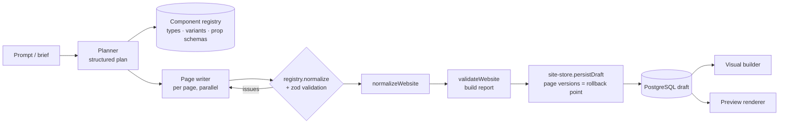

# AI agents

> AI is not a separate page generator. **AI is another operator of the existing builder.**
> Humans and agents both change websites through the same validated `SiteOperation`s and the same
> site-store persistence, so anything an agent creates is immediately editable in the visual builder.

## Packages

| Package | Role |
|---|---|
| `@atrium/providers` (`ai/*`) | Provider-neutral `AIProvider` (chat + tool calling, streaming, structured output, cost estimation) with adapters for **Anthropic Claude** (default `claude-opus-5-5`), OpenAI and Gemini. |
| `@atrium/agent` | Prompts, component/animation/theme guides generated from the registry, the site-generation workflow, the editing agent, rewrite + SEO helpers, the background job. No database or HTTP access of its own (except the job wrapper, which uses `@atrium/site-store`). |
| `@atrium/builder-core` | `SiteOperation` schema + `applyOperation` — the only way an agent can change a site. |
| `apps/api` `AiModule` | HTTP surface, RBAC, quotas, proposal storage, apply/revert, usage accounting. |
| `apps/worker` | Runs `ai.generate-site` jobs (long-running work never blocks HTTP requests). |

## Site generation (`POST /organizations/:orgId/ai/generate-site`)

A code-orchestrated workflow (not an open-ended agent), because every step has a known shape:

1. **Understanding business / Planning website** — one structured call returns a `SitePlan` (zod-validated): sitemap, per-page section sequence (only registered types + variants), theme preset + palette/font overrides, motion intensity, header/footer variants, navigation, forms, CMS collections, structured-data types.
2. **Creating design system** — `themeFromPlan` merges overrides onto a curated preset from `@atrium/design-tokens`.
3. **Creating homepage → Creating pages** — the homepage is written first (it anchors voice), then other pages in parallel (concurrency 3). The page writer sees a compact prop reference generated from the registry's JSON Schemas, the animation catalog and the image library. Output is normalized through `registry.normalize`; component errors trigger **one repair pass** that feeds the exact issues back to the model.
4. **Adding content** — CMS collection items (e.g. rooms, events, case studies).
5. **Configuring SEO** — per-page meta from the writer, site SEO + structured data from the plan, forms get notification rules when an owner email is known.
6. **Preparing preview** — `normalizeWebsite` + `validateWebsite`, then `persistDraft` replaces the placeholder draft inside a locked transaction, recording page versions as the rollback point.

Progress is written to `ai_generations.progress` and streamed by `GET /ai/generations/:id/events` (SSE) — the admin shows real steps, never a fake loader.

### Imagery

Models hallucinate stock-photo URLs. The agent references a curated, verified library (`packages/agent/src/images.ts`) as `library:<key>`; `resolveLibraryImages` turns keys into real URLs with alt text. Owner-uploaded images in the brief are preferred.

## Editing agent (`POST /websites/:id/ai/edit | generate-page | generate-section`)

A tool-calling loop (max 14 turns) over a scratch copy of the draft:

| Tool | Purpose |
|---|---|
| `get_site` | Compact overview: pages + section ids, theme tokens, navigation, forms, collections |
| `get_page` | Full section tree for one page (or `header` / `footer`) |
| `get_components` | Detailed prop reference for specific component types |
| `apply_operations` | Applies `SiteOperation[]` to the scratch copy; per-operation success/errors are returned so the model can self-correct |
| `finish` | Ends the loop with a user-facing summary |

The result is a **proposal**: `{ summary, operations, changes (diff), warnings, requiresConfirmation }`. The builder previews it by applying the same operations locally, then:

- `POST /ai/generations/:id/apply` re-validates and applies the operations as **one** versioned change (page versions with `source=AI` are the undo point; the builder records it as a single history entry).
- `POST /ai/generations/:id/revert` restores exactly the units the change touched (pages, theme, settings, forms, redirects).

Selected-node context, the current page and the site overview are sent in the first message; the system prompt (design principles + component index) is stable, so prompt caching applies.

## Content helpers

- `POST /websites/:id/ai/rewrite` — rewrite / shorten / expand / professional / luxurious / casual / SEO / translate (preserves `*emphasis*` and `{{placeholders}}`).
- `POST /websites/:id/ai/seo` — structured title/description/H1/ALT/structured-data recommendations combined with the deterministic `analyzePageSeo` checks.

## Claude specifics (Anthropic adapter)

- Default model `claude-opus-5-5` (also `claude-sonnet-5-5`, `claude-haiku-4-5`, `claude-fable-5-1`); prices in the model catalog drive cost estimates.
- Adaptive thinking is always on for Opus 5.5; depth is controlled with `output_config.effort` (`high` for generation). `budget_tokens` / disabled thinking are never sent.
- Forced `tool_choice` is not used (unsupported on current models) — tools are steered by instructions with `strict` schemas where possible.
- Thinking blocks are passed back unchanged (append-only history) via the neutral `provider_raw` content part.
- Server-side refusal fallbacks are enabled by default (`fallbacks: "default"`); a final `refusal` surfaces as a provider error.
- Structured outputs use `output_config.format` (JSON Schema) with a validation + repair retry.

## Safety boundaries

- Agents never run commands, query databases, read credentials or call other tenants. Their only write path is `SiteOperation`s validated by zod schemas **and** the component registry.
- Every AI endpoint is RBAC-checked (`ai.use` plus the permission the change requires, e.g. `page.create`), tenant-scoped, rate-limited and subject to monthly plan quotas (`aiRequestsPerMonth`, `aiTokensPerMonth`).
- Proposals are not applied until the user (or an explicit API call) applies them; publishing remains a separate, permissioned step.
- Generated HTML-bearing props pass through the same sanitizer as human edits.
- Every generation is recorded: prompt, provider, model, tokens, cost, operations, result, user, website and rollback reference (`ai_generations`), with monthly aggregates in `ai_usage`.

## Adding a provider

Implement `AIProvider` (see `packages/providers/src/ai/types.ts`), register a driver with `defineDriver({ kind: 'ai', id, configSchema, secretsSchema, create })`, and add it to `DRIVERS`. Organizations can then connect it under **Integrations → AI**; nothing in the agent changes.

## Running locally

Set `ANTHROPIC_API_KEY` in `.env` (or connect a key per organization under Integrations → AI), start the worker (`pnpm dev`), then use **Create website → Generate with AI** in the admin. Without a worker, set `DISABLE_QUEUES=true` to run generation inside the API process (development only).
