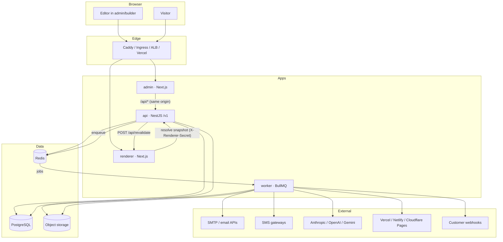
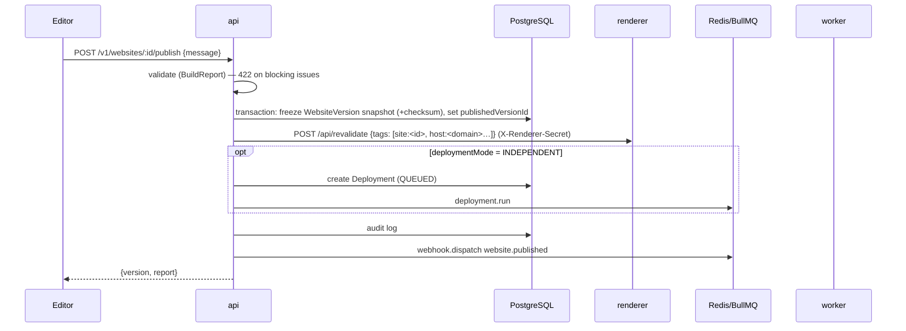
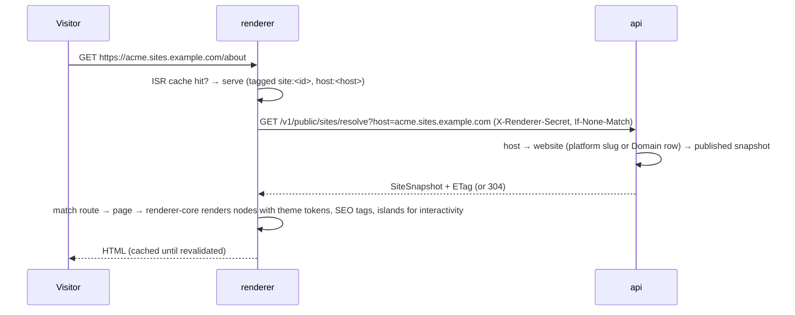
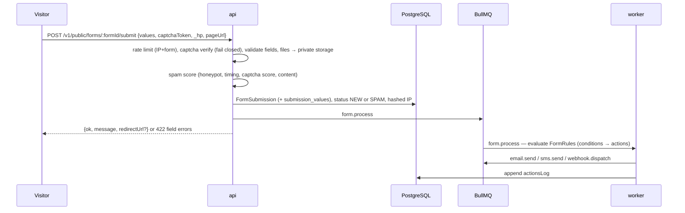
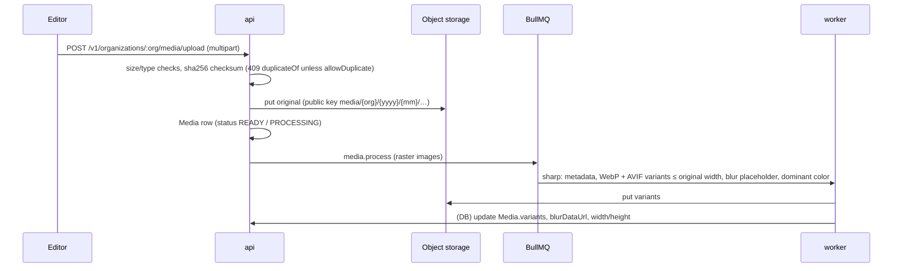
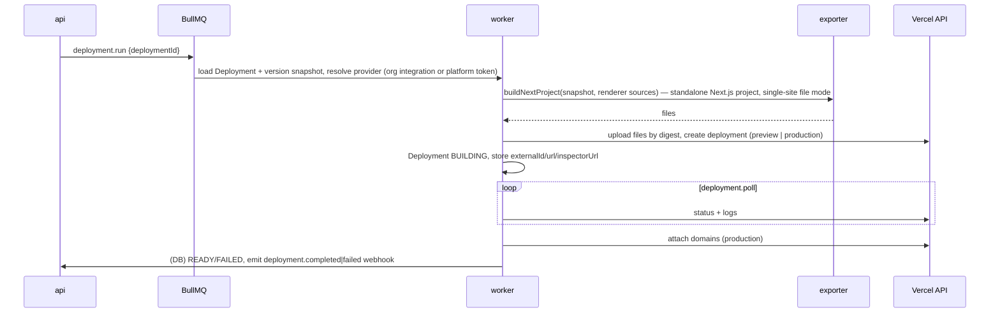

# Architecture

## Principles

1. **Schema-driven.** A website is data: settings, theme tokens, navigation, header/footer and pages whose
   documents are trees of typed nodes (`@atrium/schema`). Nothing about a site lives in code.
2. **Component-driven.** Every node type is a registry definition (`@atrium/component-registry`): zod
   props with defaults, inspector controls, variants, allowed children, animation presets and AI hints.
   The builder renders its inspector from the definition, the API validates against it, the renderer
   receives parsed props, and the AI agent reads its catalog.
3. **Configuration- and theme-driven.** Styling flows from design tokens (`@atrium/design-tokens`) compiled
   to CSS variables; components use tokens, so a theme change restyles every site consistently.
4. **Provider-driven.** Storage, email, SMS, AI, deployment, captcha and search sit behind interfaces in
   `@atrium/providers`. Business logic asks the provider resolver (`@atrium/server-kit`) for an instance;
   organizations can bring their own credentials (encrypted at rest).
5. **AI is another operator of the builder API.** The agent changes sites only through serializable,
   validated `SiteOperation`s (`@atrium/builder-core`) — the same operations the builder and SDK send.
   Every operation is permission-checked and versioned and can be reverted. The agent has no database,
   shell or file access.
6. **Immutable publishing.** Publishing freezes a `WebsiteVersion` snapshot; the renderer only ever serves
   snapshots, so drafts never leak and rollback is "publish an older snapshot".

## System overview



## Module boundaries

| Layer          | Packages                                                                                                                            | Depends on          |
| -------------- | ----------------------------------------------------------------------------------------------------------------------------------- | ------------------- |
| Contracts      | `schema` (site/page/node/form/theme schemas, permissions, plans), `design-tokens`, `animations`                                     | zod                 |
| Domain engines | `component-registry`, `builder-core` (tree ops, SiteOperations, validation, SEO, link scan, diff), `templates` (blueprints)         | contracts           |
| Rendering      | `renderer-core` (React renderers for every component, page/site rendering)                                                          | contracts, registry |
| Integration    | `providers` (drivers), `server-kit` (env, encryption, queue contracts, provider resolver, logger), `exporter`, `agent`, `db`, `sdk` | contracts           |
| Apps           | `api`, `worker`, `renderer`, `admin`                                                                                                | everything above    |

Rules: contracts and engines are framework-agnostic and shared by browser and server; only `server-kit`,
`db`, `providers`, `api` and `worker` touch secrets or the database; the renderer never touches the database
— it gets snapshots from the API.

## Multi-tenancy and RBAC

- **Tenants** are organizations. Every tenant-owned row carries `organization_id` directly or through its
  website.
- **Authorization** resolves the owning organization of the target resource from the database (ids in
  URLs are never trusted), loads the caller's membership, and checks a **permission key**
  (`page.publish`, `form.update`, …), never a role name. Roles are named bundles of permissions;
  organizations can create their own. A membership can be restricted to specific websites
  (`OrganizationMember.websiteIds`).
- **Super-admins** (`User.isSuperAdmin`) get platform permissions (`/v1/admin/*`).
- **Plans** carry limits (websites, members, storage, AI usage, custom domains) and feature flags.
- **Public traffic** is resolved by `Host`: `{slug}.PLATFORM_SITES_DOMAIN` or a `Domain` row.

## Data model and storage

PostgreSQL holds identity, tenancy, website drafts (JSONB documents with `revision` counters for
optimistic concurrency), immutable versions, forms and submissions, provider configs (secrets encrypted),
deployments, AI generations, analytics and audit logs — see [DATABASE.md](DATABASE.md). Redis holds
BullMQ queues (prefix `atrium`), rate-limit counters and short-lived caches. Object storage holds media
originals and variants, private form uploads and exports — see [STORAGE.md](STORAGE.md).

## Flows

### Authentication

```mermaid
sequenceDiagram
  participant B as Browser (admin)
  participant A as admin (Next.js)
  participant API as api
  participant DB as PostgreSQL
  B->>A: POST /api/v1/auth/login {email, password}
  A->>API: proxy
  API->>DB: find user, verify argon2id hash (+ MFA challenge if enabled)
  API->>DB: create Session (refresh token stored hashed)
  API-->>B: {accessToken (JWT, 15 min)} + Set-Cookie atrium_rt (httpOnly, SameSite=Lax)
  Note over B: access token kept in memory, sent as Authorization: Bearer
  B->>A: POST /api/v1/auth/refresh (cookie)
  A->>API: proxy
  API->>DB: rotate refresh token; reuse of a rotated token revokes all sessions
  API-->>B: new access token + new cookie
```

The admin proxies `/api/*` to the API so the refresh cookie is first-party. The CLI stores the same pair
in `~/.config/atrium/credentials.json`. MFA (TOTP) adds a challenge step (`/auth/mfa/verify`).

### Editing and autosave

The builder keeps the page document in a client store, sends `PATCH /v1/pages/:id` with the document and
the revision it edited (debounced autosave); a stale revision returns `409` with the current revision so
the client can merge or reload. Structural edits from the SDK/agents go through
`POST /v1/websites/:id/operations` (validated `SiteOperation[]` applied server-side as one change).

### Publishing



Scheduled publishing uses the same path from the API's scheduler.

### Website rendering



Previews use `GET /v1/public/preview?token=` (draft snapshot, expiring token, optional password) and
are never cached. In single-site file mode (`ATRIUM_SNAPSHOT_SOURCE=file`) the renderer reads the snapshot
from disk instead of the API, and `ATRIUM_STATIC_EXPORT=1` produces static HTML.

### Form submission



### Media upload



### AI site generation

```mermaid
sequenceDiagram
  participant E as Editor
  participant API as api
  participant Q as BullMQ
  participant W as worker (agent)
  participant LLM as AI provider
  E->>API: POST /v1/organizations/:org/ai/generate-site {brief}
  API->>API: permission ai.use, plan limits; create Website + AiGeneration (PENDING)
  API->>Q: ai.generate-site
  API-->>E: {generationId, websiteId}
  E->>API: GET /v1/ai/generations/:id/events (SSE progress)
  Q->>W: plan → pages → sections via tool calls
  W->>LLM: chat with tool definitions (JSON schemas from the registry)
  LLM-->>W: tool calls (proposed SiteOperations)
  W->>W: normalize through the registry, validate operations, apply as one versioned change
  W->>API: (DB) progress, operations, usage/cost, rollback refs → SUCCEEDED
```

Edits on existing sites (`/websites/:id/ai/edit`, `generate-page`, `generate-section`) return proposed
operations and a change summary first; `POST /ai/generations/:id/apply` applies them as one version and
`/revert` restores the pre-change state. See [AI-AGENTS.md](AI-AGENTS.md).

### Independent (Vercel) deployment



Static-only providers (e.g. Cloudflare Pages) need the worker to build the static export itself
(`WORKER_ENABLE_LOCAL_BUILDS=1`). Details: [VERCEL.md](VERCEL.md).

## Caching

| Layer                     | What                                                                                       | Invalidation                                                  |
| ------------------------- | ------------------------------------------------------------------------------------------ | ------------------------------------------------------------- |
| Renderer ISR / data cache | rendered pages and resolved snapshots, tagged `site:<id>` and `host:<hostname>`            | `POST /api/revalidate` on publish, domain or redirect changes |
| API snapshot ETag         | `GET /public/sites/resolve` returns an ETag; the renderer revalidates with `If-None-Match` | new published version                                         |
| Provider resolver         | decrypted provider instances, 60 s per row + `updated_at`                                  | automatic on update                                           |
| CDN / edge                | media (immutable keys) and static assets                                                   | never (new keys); HTML per your CDN rules                     |
| Browser                   | hashed Next.js assets immutable; HTML revalidated                                          | —                                                             |

## Scaling

The api, worker, renderer and admin are stateless processes and scale horizontally; PostgreSQL and Redis
are the shared state. Notable constraints: renderer ISR caches are per instance (revalidation must reach
every instance or use a shared cache handler), the worker scales on queue depth, and PostgreSQL connection
budgets grow with instance count. Details and per-platform guidance: [DEPLOYMENT.md](DEPLOYMENT.md#scaling).
