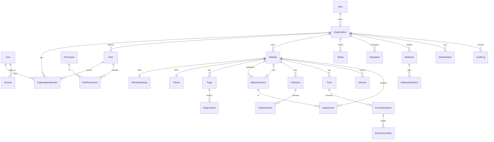

# Database

PostgreSQL 15+ (17 recommended) via Prisma 7. Schema: `packages/db/prisma/schema.prisma`; migrations:
`packages/db/prisma/migrations/`; client factory: `packages/db/src/index.ts`.

## Conventions

- `cuid()` string ids; tables and columns in `snake_case` (`@@map` / `@map`), models in PascalCase.
- Every tenant-owned row carries `organization_id` directly or through its `website_id`.
- `created_at` / `updated_at` on mutable rows; soft deletes with `deleted_at` (websites, media) or
  `archived_at` (pages, forms).
- Documents that users edit concurrently carry a `revision` integer for optimistic concurrency (pages,
  website settings, themes, forms): a save sends the revision it edited and a stale one gets `409`.
- Secrets live only in `*_enc` columns (AES-256-GCM, see [SECURITY.md](SECURITY.md)); non-secret
  provider settings are in `config` JSONB.

## Entities by domain

| Domain                | Models                                                                                                                                  | Notes                                                                                                                                                                                                |
| --------------------- | --------------------------------------------------------------------------------------------------------------------------------------- | ---------------------------------------------------------------------------------------------------------------------------------------------------------------------------------------------------- |
| Identity              | `User`, `Session`, `OAuthAccount`, `UserToken`                                                                                          | argon2id `password_hash`; sessions store hashed refresh tokens, `revoked_at`, `mfa_verified`; tokens for password reset / email verify / MFA challenge (hashed, single-use)                          |
| Tenancy & RBAC        | `Plan`, `Organization`, `Workspace`, `Permission`, `Role`, `RolePermission`, `OrganizationMember`, `Invitation`                         | plans hold `limits` JSON + features; roles are per organization (`is_system` for defaults); members link user ↔ org ↔ role, optional `website_ids` scoping                                           |
| Websites              | `Website`, `WebsiteSettings`, `Theme`, `WebsiteVersion`, `Page`, `PageVersion`, `GlobalSection`, `Template`, `Redirect`, `PreviewToken` | draft lives in settings/theme/pages; `WebsiteVersion.snapshot` is the immutable published site (`checksum`); `published_version_id` points at the live one; `deployment_mode` PLATFORM / INDEPENDENT |
| CMS                   | `Collection`, `CollectionField`, `CollectionItem`                                                                                       | typed fields; item `data` JSONB validated against fields; per-collection slugs                                                                                                                       |
| Media                 | `MediaFolder`, `Media`                                                                                                                  | `checksum` for de-duplication, `variants` JSONB (width/format/key/url), blur placeholder, dominant color, status UPLOADING/PROCESSING/READY/FAILED                                                   |
| Forms                 | `Form`, `FormField`, `FormRule`, `FormSubmission`, `SubmissionValue`, `SubmissionNote`                                                  | rules hold `when`/`then`/`otherwise` JSON; submissions normalized into `submission_values` plus a denormalized `summary` for fast listing; `spam_score`, `captcha_score`, hashed IP, `actions_log`   |
| Providers             | `EmailProvider`, `SmsProvider`, `StorageProvider`, `Integration`, `Webhook`, `WebhookDelivery`                                          | `config` JSON + `secrets_enc`; integrations by kind (AI, DEPLOYMENT, CAPTCHA, ANALYTICS, GIT, SEARCH); deliveries track attempts/status/response                                                     |
| Domains & deployments | `Domain`, `Deployment`                                                                                                                  | domain verification token, DNS/SSL status, `dns_records` guidance; deployments QUEUED → BUILDING → READY/FAILED/CANCELLED, PREVIEW/PRODUCTION, `rollback_of_id`, logs JSON                           |
| AI                    | `AiGeneration`, `AiUsage`                                                                                                               | prompt, provider/model, progress, token usage + cost, applied `operations`, `rollback` references; monthly usage per org                                                                             |
| Analytics & audit     | `AnalyticsEvent`, `AnalyticsDaily`, `AuditLog`                                                                                          | events keep a daily-rotating salted visitor hash (no cookies, no raw IPs); daily rollups; audit log with actor type USER/AI/SYSTEM/API                                                               |
| Platform              | `FeatureFlag`, `AbuseReport`                                                                                                            | flags with rules JSON (orgs/plans/percentage)                                                                                                                                                        |

## Tenancy scoping

The API never trusts ids from the URL. `AccessService` loads the resource with only its ownership
columns (`organization_id`, `website_id`), then checks the caller's membership, permission keys and
`website_ids` scope. Queries in services are additionally filtered by the resolved organization or
website. Platform templates have `organization_id = NULL`.

## JSONB vs relational

JSONB is used where the shape is a document, is versioned as a whole, or is defined by plugins/drivers:

| JSONB                                                                                       | Why                                                                                              |
| ------------------------------------------------------------------------------------------- | ------------------------------------------------------------------------------------------------ |
| `pages.document`, `page_versions.document`, `global_sections.node`                          | component trees with arbitrary depth, validated by the registry, saved/diffed/restored as a unit |
| `website_versions.snapshot`                                                                 | immutable copy of the whole published site; one read serves the renderer                         |
| `themes.tokens`, `website_settings.*`                                                       | token sets and settings evolve with the schema package                                           |
| provider `config`, `integrations.config`                                                    | each driver defines its own zod schema                                                           |
| `form_rules.when/then/otherwise`                                                            | rule ASTs                                                                                        |
| `media.variants`, `metadata`; `ai_generations.operations/rollback`; `deployments.logs/meta` | append-only or opaque payloads                                                                   |

Everything queried, joined or constrained is relational: users, memberships, roles, permissions,
websites, pages (slug uniqueness per website), domains (global hostname uniqueness), submissions and their
values (filtering, export), deliveries, audit entries.

## Indexes

Unique: `users.email`, `sessions.refresh_token_hash`, `organizations.slug`, `websites.slug`,
`websites.published_version_id`, `domains.hostname`, `templates.key`, `(organization_id, key)` on roles,
`(organization_id, user_id)` on members, `(website_id, slug)` on pages/collections/forms,
`(website_id, number)` on versions, `(page_id, number)`, `(collection_id, key|slug)`, `(form_id, name)`,
`(website_id, source)` on redirects, `(organization_id, period)` on AI usage, `(provider, provider_account_id)`.

Lookup indexes: `(organization_id)` on websites/workspaces/webhooks/storage providers;
`(website_id, status)` on pages; `(collection_id, status, position)` on items;
`(organization_id, website_id, folder_id)` and `(organization_id, checksum)` on media;
`(website_id, status, created_at)` and `(form_id, created_at)` on submissions; `(submission_id)` on values;
`(webhook_id, created_at)` on deliveries; `(website_id, created_at)` on deployments, analytics events,
AI generations and audit logs; `(organization_id, created_at)` on audit logs and AI generations.

## Prisma 7 specifics

- Generator `prisma-client` writes to `packages/db/src/generated/prisma` (git-ignored); `pnpm --filter
@atrium/db build` compiles it into `dist/`. `postinstall` runs `prisma generate`.
- The client uses the **driver adapter** `@prisma/adapter-pg` (node-postgres); pool size per process
  is `DATABASE_POOL_SIZE` (default 10).
- `prisma.config.ts` loads the monorepo root `.env`, so `pnpm db:*` scripts work from any directory.

## Migrations

| Task                      | Command                                                                                     |
| ------------------------- | ------------------------------------------------------------------------------------------- |
| Change the schema locally | edit `schema.prisma`, then `pnpm db:migrate` or `pnpm atrium migrate --dev --name <change>` |
| Apply in any environment  | `pnpm db:deploy`, `pnpm atrium migrate`, the `atrium-migrate` image/Job                     |
| Status                    | `pnpm atrium migrate --status` (also in `atrium status` / `atrium doctor`)                  |
| Reset local data          | `pnpm atrium db reset --force`                                                              |

Rules:

- Never edit a migration that has been applied anywhere; add a new one.
- CI applies all migrations to an empty PostgreSQL 17 and fails if `schema.prisma` drifts from them
  (`prisma migrate diff --from-config-datasource --to-schema prisma/schema.prisma --exit-code`).
- Zero-downtime releases use **expand → backfill → contract** across releases; create large indexes
  `CONCURRENTLY` in their own migration (Prisma runs each migration in a transaction unless it contains
  statements that cannot run inside one).
- Failed migrations block later deploys: inspect, fix, then `prisma migrate resolve --rolled-back|--applied <name>`.

## Seeding

`pnpm db:seed` (`atrium seed`) runs `apps/api/scripts/seed.ts`: plans, the permission catalog, platform
templates/blueprints and the super-admin from `SEED_ADMIN_EMAIL` / `SEED_ADMIN_PASSWORD`. It is meant to
be idempotent. `atrium seed --demo` sets `SEED_DEMO=1` for demo content.

## Backups and restore

- `atrium backup [--with-files] [--keep N]` — `pg_dump --clean --if-exists --no-owner --no-privileges`
  gzipped, with a manifest listing applied migrations and sha256 checksums;
  `atrium restore <name|latest> --force` verifies checksums and refuses backups newer than the checkout.
- `infra/scripts/backup.sh` — the same dump without Node.js (cron/systemd timer); the Kubernetes base
  ships an `atrium-backup` CronJob uploading to S3.
- Managed databases: keep point-in-time recovery on in addition to logical dumps.

## Data lifecycle and privacy

- Analytics store no cookies or raw IPs; visitor/session hashes use a daily-rotating salt
  (`ANALYTICS_SALT`). Old `analytics_events` can be deleted after rollup into `analytics_daily`.
- Submissions can be deleted individually or in bulk; deleting a website cascades to its content.
- Submission IPs are stored as hashes; user agents are truncated.

## Performance notes

- Budget connections: `instances × DATABASE_POOL_SIZE` < `max_connections`. With PgBouncer use
  transaction pooling and check driver-adapter compatibility (avoid session-level features).
- `analytics_events` is the fastest-growing table; consider time-based partitioning and retention for
  large installations.
- Page documents are fetched whole; keep very large pages in mind when setting `UPLOAD_MAX_MB` and
  proxy body limits.
