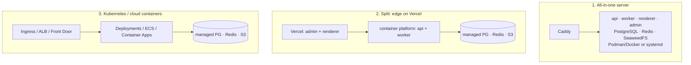

# Deployment

Atrium is four processes plus three backing services:

| Process                                                          | Kind                      | Scales                     | Notes                                                                                          |
| ---------------------------------------------------------------- | ------------------------- | -------------------------- | ---------------------------------------------------------------------------------------------- |
| `api` (NestJS, :4000)                                            | stateless HTTP            | horizontally               | `/v1/health` liveness, `/v1/health/ready` checks PostgreSQL + Redis                            |
| `worker` (BullMQ)                                                | **long-running consumer** | horizontally               | email, SMS, webhooks, form rules, media (sharp), deployments, AI generation, analytics rollups |
| `renderer` (Next.js, :3001)                                      | HTTP, ISR cache           | horizontally (see caching) | multi-tenant by `Host`; or single-site/static mode                                             |
| `admin` (Next.js, :3000)                                         | HTTP                      | horizontally               | proxies `/api/*` to the API (target baked at build time)                                       |
| PostgreSQL 15+ (17 recommended)                                  |                           | managed or self-hosted     | MySQL is not supported                                                                         |
| Redis 7                                                          |                           | managed or self-hosted     | `maxmemory-policy noeviction`, persistence on                                                  |
| S3-compatible storage (or Azure Blob, or local disk on one node) |                           | managed                    | public media + private uploads                                                                 |

**Do not put the worker on serverless.** Vercel/Netlify functions, AWS Lambda and request-scoped
container platforms (Cloud Run services, App Runner) stop or throttle idle instances and time out long
jobs. The worker needs a normal process: a container service, VM, or Kubernetes Deployment. The API also
expects a persistent process (Redis connections, SSE streams, uploads processed with sharp).

## Choose a topology



| Topology                                                         | Good for                       | Guide                                                                          | Generate with                             |
| ---------------------------------------------------------------- | ------------------------------ | ------------------------------------------------------------------------------ | ----------------------------------------- |
| One VPS with Podman (compose or Quadlet) + Caddy                 | first production, small/medium | [vps-podman.md](deployment/vps-podman.md)                                      | `atrium setup production --target podman` |
| One VPS with Docker Compose                                      | same, Docker shops             | [vps-podman.md](deployment/vps-podman.md)                                      | `--target docker`                         |
| VM with systemd + nginx, Node on the host                        | no containers                  | [vps-podman.md](deployment/vps-podman.md#5c-without-containers-systemd--nginx) | `--target systemd`                        |
| Kubernetes (any distribution)                                    | scale, GitOps                  | [kubernetes.md](deployment/kubernetes.md)                                      | `--target k8s`                            |
| AWS: ECS Fargate + RDS + ElastiCache + S3                        | AWS shops                      | [aws.md](deployment/aws.md)                                                    | `--target aws`                            |
| Azure: Container Apps + Flexible Server + Cache for Redis + Blob | Azure shops                    | [azure.md](deployment/azure.md)                                                | `--target azure`                          |
| GCP: Cloud Run + GKE/VM worker + Cloud SQL + Memorystore + GCS   | GCP shops                      | [gcp.md](deployment/gcp.md)                                                    | `--target gcp`                            |
| DigitalOcean App Platform or Droplet                             | simple managed                 | [digitalocean.md](deployment/digitalocean.md)                                  | `--target docker` / `podman`              |
| Fly.io, Railway, Render                                          | PaaS                           | [fly-railway-render.md](deployment/fly-railway-render.md)                      | `--target fly` / `railway` / `render`     |
| Vercel for admin + renderer, containers for api/worker           | global edge for sites          | [vercel.md](deployment/vercel.md)                                              | `--target vercel`                         |
| cPanel / shared hosting for public sites                         | existing hosting accounts      | [cpanel.md](deployment/cpanel.md)                                              | `--target cpanel`                         |
| Cloudflare (R2, Pages, DNS, SaaS custom hostnames, Tunnel)       | add-on to any topology         | [cloudflare.md](deployment/cloudflare.md)                                      | —                                         |

`atrium setup production` writes the target's files into `deploy/<target>/` (git-ignored) with a
production `.env` containing fresh secrets, and prints next steps. `atrium setup check --env-file <file>`
lints the result. Per-site **independent deployments** (each customer site deployed to Vercel, Netlify,
Cloudflare Pages or a self-hosted target) are independent of how the platform itself is hosted; see
[VERCEL.md](VERCEL.md).

## Hostnames

| Host                                       | Serves                                                                         |
| ------------------------------------------ | ------------------------------------------------------------------------------ |
| `admin.example.com`                        | admin + builder                                                                |
| `api.example.com`                          | REST API                                                                       |
| `sites.example.com`, `*.sites.example.com` | renderer; tenant sites at `{slug}.sites.example.com`                           |
| `media.example.com`                        | public media (bucket/CDN)                                                      |
| customer domains                           | CNAME to `sites.example.com` (`PLATFORM_CNAME_TARGET`), served by the renderer |

TLS for tenant subdomains and customer domains: Caddy on-demand TLS (asks
`GET /v1/public/domains/check?domain=` before issuing), a wildcard certificate via DNS-01 plus
per-domain certificates (cert-manager, ACM, Certificate Manager), Cloudflare for SaaS, or the hosting
platform's managed certificates.

If possible, serve tenant sites from a separate registrable domain (`example-sites.com`) so customer
custom code never shares a cookie scope with the admin — and in any case keep `COOKIE_DOMAIN` set to the
admin host.

## Environment reference

All processes read the same variables (root `.env.example`; validated by `packages/server-kit/src/env.ts`
and `apps/api/src/config/env.ts`).

| Variable                                                                                                                    | Used by                      | Production value / notes                                                                                                                                    |
| --------------------------------------------------------------------------------------------------------------------------- | ---------------------------- | ----------------------------------------------------------------------------------------------------------------------------------------------------------- |
| `NODE_ENV`                                                                                                                  | all                          | `production`                                                                                                                                                |
| `ADMIN_URL`, `API_URL`, `RENDERER_URL`, `PREVIEW_URL`                                                                       | all                          | public https URLs                                                                                                                                           |
| `PLATFORM_SITES_DOMAIN`                                                                                                     | api, renderer                | `sites.example.com` (no port)                                                                                                                               |
| `PLATFORM_CNAME_TARGET`, `PLATFORM_INGRESS_IP`                                                                              | api                          | DNS guidance shown for custom domains                                                                                                                       |
| `API_PORT`                                                                                                                  | api                          | 4000                                                                                                                                                        |
| `DATABASE_URL`                                                                                                              | api, worker, migrate         | `postgresql://…?sslmode=require` for remote servers                                                                                                         |
| `DATABASE_POOL_SIZE`                                                                                                        | api, worker                  | connections per process (default 10)                                                                                                                        |
| `REDIS_URL`                                                                                                                 | api, worker                  | `redis://` or `rediss://`; noeviction                                                                                                                       |
| `QUEUE_PREFIX`                                                                                                              | api, worker                  | BullMQ key prefix (default `atrium`)                                                                                                                        |
| `JWT_ACCESS_SECRET`, `JWT_REFRESH_SECRET`                                                                                   | api                          | ≥ 32 random chars; `JWT_ACCESS_TTL` (s), `REFRESH_TTL_DAYS`                                                                                                 |
| `ENCRYPTION_KEY`                                                                                                            | api, worker                  | 32 bytes base64 — losing it makes stored provider credentials unreadable; rotation via `ENCRYPTION_KEYS` + `ENCRYPTION_KEY_ID` ([SECURITY.md](SECURITY.md)) |
| `RENDERER_SECRET`                                                                                                           | api, renderer                | shared secret for snapshot resolution and revalidation                                                                                                      |
| `ANALYTICS_SALT`                                                                                                            | api                          | salt for visitor hashes                                                                                                                                     |
| `COOKIE_DOMAIN`, `COOKIE_SECURE`                                                                                            | api                          | admin host; `true`                                                                                                                                          |
| `CORS_ORIGINS`                                                                                                              | api                          | `https://admin.example.com`                                                                                                                                 |
| `TRUST_PROXY`                                                                                                               | api                          | `true` behind a proxy/load balancer (default)                                                                                                               |
| `STORAGE_DRIVER`                                                                                                            | api, worker                  | `s3` \| `azure-blob` \| `local` (single node only)                                                                                                          |
| `S3_ENDPOINT`, `S3_REGION`, `S3_BUCKET`, `S3_ACCESS_KEY_ID`, `S3_SECRET_ACCESS_KEY`, `S3_FORCE_PATH_STYLE`, `S3_PUBLIC_URL` | api, worker                  | empty keys = AWS default credential chain                                                                                                                   |
| `AZURE_STORAGE_ACCOUNT`, `AZURE_STORAGE_CONTAINER`, `AZURE_STORAGE_KEY`                                                     | api, worker                  | for `azure-blob`                                                                                                                                            |
| `LOCAL_STORAGE_DIR`, `LOCAL_STORAGE_PUBLIC_URL`                                                                             | api, worker                  | for `local`                                                                                                                                                 |
| `UPLOAD_MAX_MB`                                                                                                             | api                          | default 100                                                                                                                                                 |
| `SMTP_HOST`, `SMTP_PORT`, `SMTP_SECURE`, `SMTP_USER`, `SMTP_PASSWORD`, `MAIL_FROM`                                          | worker                       | platform email (password resets, invitations, default notifications)                                                                                        |
| `AI_DEFAULT_PROVIDER`, `ANTHROPIC_API_KEY`, `ANTHROPIC_MODEL`, `OPENAI_API_KEY`, `GEMINI_API_KEY`                           | api, worker                  | optional platform AI keys; organizations can bring their own                                                                                                |
| `VERCEL_TOKEN`, `VERCEL_TEAM_ID`                                                                                            | worker                       | optional platform deployment token                                                                                                                          |
| `WORKER_ENABLE_LOCAL_BUILDS`                                                                                                | worker                       | `1` lets the worker build static exports for static-only deployment providers                                                                               |
| `ATRIUM_REPO_ROOT`                                                                                                          | worker                       | monorepo path used by the exporter (set to `/app` in the image)                                                                                             |
| `ATRIUM_API_INTERNAL_URL`                                                                                                   | admin (build time), renderer | API URL reachable from the server side                                                                                                                      |
| `LOG_LEVEL`, `SENTRY_DSN`, `OTEL_EXPORTER_OTLP_ENDPOINT`                                                                    | all                          | observability                                                                                                                                               |
| `SEED_ADMIN_EMAIL`, `SEED_ADMIN_PASSWORD`                                                                                   | seed                         | initial super-admin                                                                                                                                         |

## Images

`infra/containers/{api,worker,renderer,admin}.Containerfile` build multi-stage images (turbo prune →
frozen pnpm install → turbo build → production-only reinstall → `node:24-slim`, user `node`, tini, OCI
labels, healthchecks). `api.Containerfile --target migrate` builds `atrium-migrate` (Prisma CLI +
migrations). CI pushes all five to GHCR on every push to `main` and on tags.

```bash
podman build --format docker -f infra/containers/api.Containerfile -t atrium-api .
podman build --format docker -f infra/containers/api.Containerfile --target migrate -t atrium-migrate .
podman build --format docker -f infra/containers/admin.Containerfile --build-arg ATRIUM_API_INTERNAL_URL=http://api:4000 -t atrium-admin .
```

Builds need about 4 GiB of RAM for the API and 6 GiB for the Next.js apps; on small builders pass
`--build-arg TURBO_CONCURRENCY=1`.

## Releases and zero-downtime migrations

Every release is: **build images → run `atrium-migrate` (prisma migrate deploy) → roll out
api/worker/renderer/admin**. The deploy workflows (`.github/workflows/deploy-*.yml`), compose
(`migrate` must complete before api/worker start), Quadlet, the Kubernetes Job and the ECS/Container Apps/
Cloud Run jobs all follow this order.

Because old instances keep serving while migrations run, migrations must be backward compatible:

1. **Expand** — add tables/columns (nullable or with defaults), add indexes `CONCURRENTLY` in a separate
   migration where tables are large.
2. **Deploy** code that writes both shapes and reads the new one.
3. **Backfill** in batches (a script or a worker job).
4. **Contract** in a later release — drop old columns/tables.

Never edit a migration that has been applied anywhere. CI fails when `schema.prisma` and the migrations
disagree (`prisma migrate diff --from-config-datasource --to-schema prisma/schema.prisma --exit-code`).
See [DATABASE.md](DATABASE.md).

## Scaling

- **api** — stateless; scale on CPU. Sessions are in PostgreSQL, rate-limit counters in Redis.
- **worker** — scale on queue depth (`atrium:<queue>:wait` lists; `atrium status` shows counts). Jobs are
  retried with exponential backoff; give pods a long termination grace period so jobs finish.
- **renderer** — each instance has its own ISR cache. On publish the API calls
  `POST {RENDERER_URL}/api/revalidate` once with tags `site:<id>` and `host:<domain>`; behind a load
  balancer only one instance receives it. Either keep one renderer per region, fan revalidation out to
  every instance (the Kubernetes base ships a headless `atrium-renderer-peers` Service for that), or
  configure a shared Next.js cache handler. Vercel's ISR cache is shared, so no fan-out is needed there.
- **PostgreSQL** — budget `instances × DATABASE_POOL_SIZE` below `max_connections`; use PgBouncer
  (transaction pooling) for many instances. `analytics_events` grows fastest; rollups go to
  `analytics_daily`.
- **Redis** — memory grows with retained completed/failed jobs (bounded by the queue `removeOnComplete`
  settings); watch `used_memory` and keep `noeviction`.

## Backups and disaster recovery

| What           | How                                                                                                                                                                                    |
| -------------- | -------------------------------------------------------------------------------------------------------------------------------------------------------------------------------------- |
| PostgreSQL     | managed PITR + daily logical dumps: `atrium backup` (pg_dump → gzip, checksummed manifest, `--keep N`), `infra/scripts/backup.sh` (no Node), or the Kubernetes `atrium-backup` CronJob |
| Object storage | bucket versioning/replication; `atrium backup --with-files` archives the bucket for small installs                                                                                     |
| Secrets        | `ENCRYPTION_KEY`(s) and JWT secrets in your secret manager — without `ENCRYPTION_KEY` provider credentials cannot be decrypted                                                         |
| Restore        | `atrium restore <backup> [--with-files] --force`, then `atrium migrate` if the code is newer                                                                                           |

Test restores regularly; backups contain personal data and password hashes, so encrypt them at rest.

## Observability

- **Logs** — JSON lines from pino (`LOG_LEVEL`), with secrets redacted; ship stdout to your log platform.
- **Health** — `/v1/health` (liveness) and `/v1/health/ready` (PostgreSQL + Redis) for probes and uptime checks.
- **Errors and traces** — `SENTRY_DSN` and `OTEL_EXPORTER_OTLP_ENDPOINT` are recognised by the shared env
  schema for Sentry and OpenTelemetry exporters.
- **Queues** — `atrium status`, the super-admin Jobs page (`GET /v1/admin/jobs`), or any BullMQ dashboard
  pointed at the `atrium` prefix.
- **Diagnostics** — `atrium doctor` checks configuration, secret strength, connectivity, migrations and
  ports; with `NODE_ENV=production` it also runs the production readiness lint.
