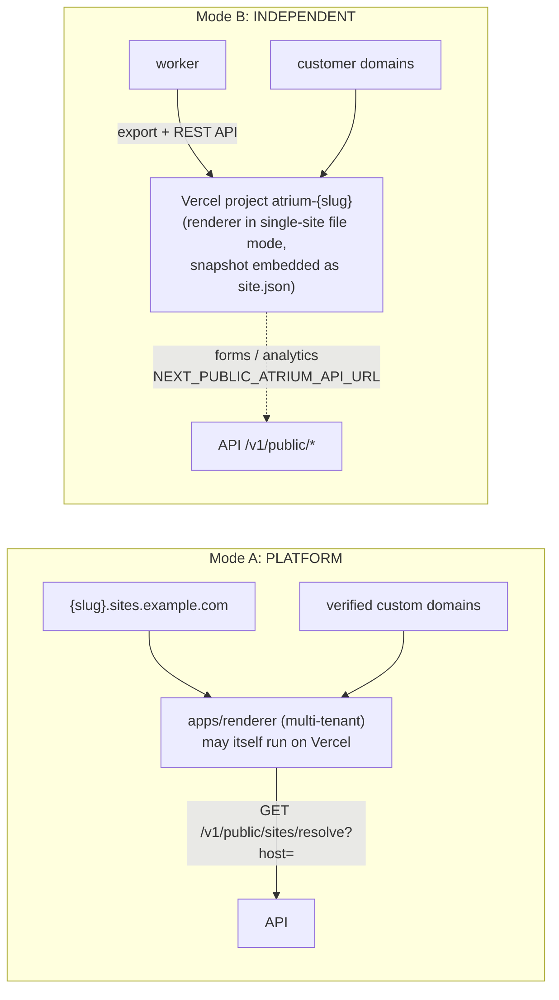
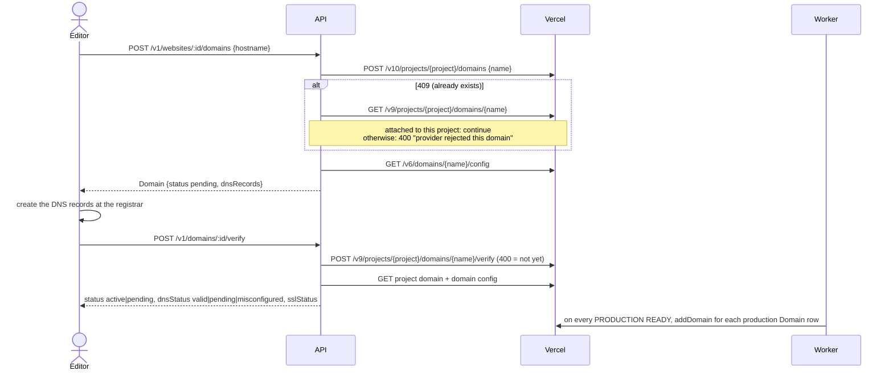

# Vercel deployment provider

This document describes how Atrium uses Vercel: as a host for the platform's own Next.js apps (Mode A) and as a
per-website deployment target driven by the Vercel REST API (Mode B, "independent deployments"). It is written
against the code as it is today; anything not implemented is marked **planned** or listed under
[Known gaps](#known-gaps).

Step-by-step setup lives in [deployment/vercel.md](deployment/vercel.md). This file covers the internals.

Source map:

| Concern                                 | Code                                                                                                    |
| --------------------------------------- | ------------------------------------------------------------------------------------------------------- |
| Provider interface                      | `packages/providers/src/deployment/types.ts`                                                            |
| Vercel driver                           | `packages/providers/src/deployment/vercel.ts`                                                           |
| File hashing, path normalisation        | `packages/providers/src/deployment/digest.ts`                                                           |
| Apex/subdomain detection                | `packages/providers/src/deployment/dns.ts`                                                              |
| Platform-hosted driver (Mode A)         | `packages/providers/src/deployment/self-hosted.ts`                                                      |
| HTTP client (errors, retryability)      | `packages/providers/src/http.ts`                                                                        |
| Standalone Next.js export               | `packages/exporter/src/next-project.ts`                                                                 |
| Provider resolution, secret decryption  | `packages/server-kit/src/providers.ts`, `packages/server-kit/src/crypto.ts`                             |
| Queue names, job payloads, retry policy | `packages/server-kit/src/queues.ts`                                                                     |
| Deployment job processing               | `apps/worker/src/processors/deployments.ts`                                                             |
| REST endpoints                          | `apps/api/src/modules/{deployments,domains,publishing,websites}`                                        |
| Data model                              | `packages/db/prisma/schema.prisma` (`Website`, `WebsiteVersion`, `Deployment`, `Domain`, `Integration`) |

---

## 1. Two modes

`Website.deploymentMode` (enum `DeploymentMode`, default `PLATFORM`) decides where a published site is served.



### Mode A: PLATFORM

- Every site is served by the single multi-tenant renderer (`apps/renderer`), selected by `Host` header:
  `{slug}.PLATFORM_SITES_DOMAIN` or a verified custom domain.
- The renderer fetches the published snapshot from the API (`X-Renderer-Secret`) and caches it with ISR.
  On publish the API calls `POST {RENDERER_URL}/api/revalidate` with tags `site:{websiteId}` and `host:{hostname}`
  for each of the site's domains (`PublishingService.revalidate`).
- The deployment provider for this mode is the `self-hosted` driver (`SelfHostedDeploymentProvider`). It uploads
  nothing: `deploy()` returns `status: 'ready'` immediately with id `self-<label>-<stamp>` and URL
  `https://{slug}.{PLATFORM_SITES_DOMAIN}`. The worker records the row as `READY` and, for `PRODUCTION`, sets
  `Website.publishedVersionId`.
- The renderer itself may be hosted on Vercel (wildcard `*.sites.example.com` on a Vercel project). That is a
  hosting choice for the platform, not a per-site Vercel deployment; nothing in the deployment pipeline calls the
  Vercel API in this mode. See [deployment/vercel.md](deployment/vercel.md) part A.
- Publishing in PLATFORM mode does not create a `Deployment` row. It freezes a version and revalidates the renderer.
  A `Deployment` row (provider `self-hosted`) is only created when someone triggers one explicitly
  (`POST /v1/websites/:id/deployments`).

### Mode B: INDEPENDENT

- Each website is deployed as its own Vercel project, named `atrium-{slug}`. The name comes from
  `projectNameFor(slug)` in the worker and is passed through `sanitizeVercelProjectName`. It is persisted on
  `Website.externalProject` after the first successful submission.
- The worker generates a standalone Next.js project: the renderer source in single-site file mode, with the
  published snapshot embedded as `site.json`. It uploads the files to Vercel and creates a deployment. Vercel then
  runs `npm install` and `next build` on its own build infrastructure.
- Required website fields: `deploymentMode = INDEPENDENT` and `deploymentIntegrationId` (an `Integration` row of
  kind `DEPLOYMENT`). `deploymentProvider` is copied from the integration's `driver` (for example `vercel`) when
  the integration is selected (`WebsitesService.update`). `PATCH /v1/websites/:id` needs `deployment.publish` to
  change either field.
- Publishing (`POST /v1/websites/:id/publish`) and republishing an older version
  (`POST /v1/websites/:id/versions/:versionId/publish`) automatically queue a `PRODUCTION` deployment when the
  website is INDEPENDENT and has an integration. Preview deployments are always manual.
- The site keeps working on the platform renderer at `{slug}.PLATFORM_SITES_DOMAIN`, because the public resolve
  endpoint does not filter by `deploymentMode`. INDEPENDENT adds a Vercel copy; it does not switch the platform
  copy off.

---

## 2. From publish to a READY deployment

### Data involved

| Model            | Fields that matter                                                                                                                                                                                                                                                                                                                                                                                                        |
| ---------------- | ------------------------------------------------------------------------------------------------------------------------------------------------------------------------------------------------------------------------------------------------------------------------------------------------------------------------------------------------------------------------------------------------------------------------- |
| `WebsiteVersion` | Immutable `snapshot` (a `SiteSnapshot`: `websiteId`, `versionId`, `version`, `publishedAt`, `apiBaseUrl`, `primaryDomain`, `definition`, `runtime`), `number`, `checksum`                                                                                                                                                                                                                                                 |
| `Deployment`     | `websiteId`, `versionId`, `provider` (`vercel`, `self-hosted`, ...), `target` (`PREVIEW`/`PRODUCTION`), `status` (`QUEUED`/`BUILDING`/`READY`/`FAILED`/`CANCELLED`), `externalId` (Vercel deployment id), `url`, `inspectorUrl`, `error`, `logs` (JSON array, capped at 500 lines), `meta` (JSON: `integrationId`, `action`, `projectName`, `projectId`, ...), `rollbackOfId`, `triggeredById`, `startedAt`, `finishedAt` |
| `Website`        | `deploymentMode`, `deploymentProvider`, `deploymentIntegrationId`, `externalProject`, `publishedVersionId`                                                                                                                                                                                                                                                                                                                |

### Sequence

```mermaid
sequenceDiagram
  autonumber
  actor U as Editor
  participant API as API (NestJS)
  participant DB as PostgreSQL
  participant Q as Redis / BullMQ (queue "deployment")
  participant W as Worker
  participant X as Exporter
  participant V as Vercel REST API

  U->>API: POST /v1/websites/:id/publish
  API->>API: validateWebsite (422 on blocking issues)
  API->>DB: freezeVersion: WebsiteVersion (immutable snapshot), publishedVersionId
  API->>API: revalidate platform renderer (best effort)
  API->>DB: Deployment {target PRODUCTION, status QUEUED, provider vercel, meta.integrationId}
  API->>Q: deployment.run {deploymentId} (jobId deploy-<id>, attempts 1)
  API-->>U: {version, report}
  Q->>W: deployment.run
  W->>DB: status BUILDING, startedAt
  W->>W: resolve provider (integration -> decrypt secretsEnc)
  W->>X: buildNextProject(snapshot, staticExport false)
  X-->>W: file map (renderer src + vendored packages + site.json + manifests)
  W->>V: GET /v9/projects/atrium-{slug} (404 means create)
  W->>V: POST /v11/projects (only when missing)
  W->>V: POST /v10/projects/{id}/env?upsert=true
  W->>V: POST /v13/deployments {files: [{file, sha, size}]}
  V-->>W: 400 missing_files [sha...]
  W->>V: POST /v2/files (x-vercel-digest: sha1), 8 in parallel, missing only
  W->>V: POST /v13/deployments (retry once)
  V-->>W: {id, url, readyState, inspectorUrl}
  W->>DB: externalId, url, inspectorUrl, logs; Website.externalProject
  W->>Q: deployment.poll {attempt 0} (delay 5 s)
  loop until READY / ERROR / CANCELED, or 720 attempts
    Q->>W: deployment.poll
    W->>V: GET /v13/deployments/{id}
    W->>V: GET /v3/deployments/{id}/events?builds=1
    W->>DB: status + logs ("[provider]" lines replaced on each poll)
  end
  W->>DB: READY, finishedAt; PRODUCTION: publishedVersionId, status PUBLISHED
  W->>V: POST /v10/projects/{project}/domains (each production Domain row)
  W->>Q: webhook.dispatch deployment.completed / deployment.failed
  W->>DB: AuditLog (actor SYSTEM, "Deployment worker")
```

### Step details

1. **Snapshot.** `freezeVersion` (in `@atrium/site-store`) writes an immutable `WebsiteVersion` row and points
   `Website.publishedVersionId` at it. `snapshot.apiBaseUrl` is `{API_URL}/v1`.
2. **Deployment row.** `DeploymentsService.create` resolves `versionId` (the request body, or else the current
   `publishedVersionId`). It sets `provider` to `deploymentProvider ?? 'vercel'` for INDEPENDENT sites and to
   `self-hosted` otherwise. It enqueues `deployment.run` with `jobId: deploy-<deploymentId>` and `attempts: 1`
   (this overrides the queue default of 2). It also emits a `deployment.created` webhook event.
3. **Provider resolution.** `ProviderResolver.deployment()` (server-kit) checks, in order: the explicit integration
   id (`meta.integrationId` or `Website.deploymentIntegrationId`), then a website-scoped `DEPLOYMENT`
   integration, then the organization's default `DEPLOYMENT` integration, then the most recently updated one. It
   then falls back to the platform `VERCEL_TOKEN` / `VERCEL_TEAM_ID`. Instances are cached for 60 s, keyed by
   integration id and `updatedAt`. See [section 7](#7-credentials-and-token-scopes) for the limits on that last
   fallback.
4. **Export.** `buildNextProject({ snapshot, repoRoot, apiBaseUrl, staticExport: false })` produces:
   - every file under `apps/renderer`, except `node_modules`, `.next`, `.turbo`, `.vercel`, `.git`, `dist`, `out`,
     tests and `.env*`;
   - `packages/<dir>/src/**` for the transitive `@atrium/*` workspace dependencies of the renderer, each with a
     minimal `package.json`, resolved through `tsconfig.json` `paths`;
   - a generated `package.json` (version `1.0.<snapshot.version>`, merged third-party dependencies, no lockfile),
     `tsconfig.json`, `next.config.ts` (`output: 'export'` only when `ATRIUM_STATIC_EXPORT=1`), `next-env.d.ts`;
   - `.env.production` containing `ATRIUM_SNAPSHOT_SOURCE=file`, `ATRIUM_SNAPSHOT_FILE=./site.json` and
     `ATRIUM_API_URL` / `NEXT_PUBLIC_ATRIUM_API_URL` (public values only);
   - `site.json` (the snapshot), `vercel.json` (`framework: nextjs`, `installCommand: npm install`,
     `buildCommand: npm run build`), `.gitignore` and `README.md`.

   Media is **not** copied. The snapshot references media by URL (platform storage / `S3_PUBLIC_URL` / CDN), so
   the deployed site loads images from the platform's media host. `collectMediaReferences` (`media.ts`) is used
   for bundle exports, not by the deploy path.

   The worker sends Vercel the **unbuilt** source and Vercel builds it. Static export is only used for
   `netlify` and `cloudflare-pages` (`STATIC_ONLY` in the worker). Those require `WORKER_ENABLE_LOCAL_BUILDS=1`
   because the worker runs `npm install` and `next build` itself. The Vercel driver supports
   `framework: 'static'` (the project framework is set to `null`), but the worker never selects it for Vercel.

5. **Project and env.** `ensureProject` reuses an existing project with the sanitised name in the token's scope,
   or creates one with `framework` (default `nextjs`), `nodeVersion` (default `24.x`) and any configured
   `buildCommand`, `outputDirectory`, `installCommand` and `rootDirectory`. `upsertEnv` writes `encrypted` env vars
   for the `production` and `preview` targets: `ATRIUM_SNAPSHOT_SOURCE=file`, `ATRIUM_SNAPSHOT_FILE=./site.json`
   and, when the snapshot has one, `NEXT_PUBLIC_ATRIUM_API_URL`.
6. **Upload on demand.** Each file is hashed once with SHA-1 (`digestFiles`). Paths are normalised to POSIX form,
   and `..` or empty segments are rejected (`normalizeFilePath`). The worker creates the deployment first. When
   Vercel answers `400 missing_files`, it uploads only the listed digests to `/v2/files`, or every file if the list
   is absent. Uploads deduplicate by digest, run 8 at a time with a 120 s timeout each, and the create call is
   retried once. Unchanged files from earlier deployments are not re-uploaded.
7. **Polling.** `deployment.poll` runs every `WORKER_DEPLOYMENT_POLL_MS` (default 5000 ms) and gives up after
   `WORKER_DEPLOYMENT_POLL_MAX_ATTEMPTS` (default 720, about 1 hour). On timeout the row is marked `FAILED` with
   "Timed out waiting for the provider". Vercel states map as follows (`mapVercelState`):

   | Vercel `readyState`               | Atrium status                                  |
   | --------------------------------- | ---------------------------------------------- |
   | `QUEUED`, `INITIALIZING`, unknown | `QUEUED`                                       |
   | `BUILDING`                        | `BUILDING`                                     |
   | `READY`                           | `READY`                                        |
   | `ERROR`                           | `FAILED` (`error` = `errorCode: errorMessage`) |
   | `CANCELED`                        | `CANCELLED`                                    |

8. **Terminal side effects run once.** `applyInfo` updates the row with
   `updateMany(where status not in READY/FAILED/CANCELLED)` and runs side effects only when that update changed a
   row. On `READY` + `PRODUCTION` it sets `Website.publishedVersionId` and `status = PUBLISHED`, attaches the
   site's production `Domain` rows to the Vercel project, and emits `deployment.completed`. On `FAILED` it emits
   `deployment.failed`. Both events are also written to `AuditLog`.

### Logs

`Deployment.logs` stores the worker's own lines (start, export size, provider acceptance, errors) together with the
Vercel build log, which is fetched from `GET /v3/deployments/{id}/events?builds=1&direction=forward&limit=2000`.
Provider lines are prefixed `[provider] ` and replaced in full on every poll. The total is capped at the last 500
lines. `stderr`/`error`/`fatal` events map to level `error`, and `warning` events map to `warn`.

Where to read them:

- the deployment sheet in the admin (website, then Deployments, then a row), backed by
  `GET /v1/deployments/:id`, which includes logs;
- `Deployment.inspectorUrl`, which links to the Vercel dashboard page with the full build output;
- worker stdout (pino) for resolver and export errors that happen before Vercel is involved.

### Queue and retry policy

| Job               | Queue        | Attempts                            | Backoff          | Worker concurrency                  |
| ----------------- | ------------ | ----------------------------------- | ---------------- | ----------------------------------- |
| `deployment.run`  | `deployment` | 1 (set by the API; queue default 2) | exponential 15 s | 2 (`WORKER_CONCURRENCY_DEPLOYMENT`) |
| `deployment.poll` | `deployment` | 5                                   | exponential 5 s  | shared                              |

The lock duration on the `deployment` queue is 10 minutes, which leaves time for large exports and uploads. HTTP
errors are retryable for 408/425/429/5xx and network errors (`ProviderError.retryable`), but with `attempts: 1` a
failed `deployment.run` is not retried automatically. Use **Redeploy** instead.

---

## 3. Preview and production targets

|                       | Preview                                                       | Production                                                  |
| --------------------- | ------------------------------------------------------------- | ----------------------------------------------------------- |
| API                   | `POST /v1/websites/:id/deployments {target: "preview"}`       | `{target: "production"}`, or automatic on publish           |
| Permission            | `deployment.preview`                                          | `deployment.publish`                                        |
| Vercel request        | `target` omitted, so Vercel creates a preview deployment      | `target: "production"`                                      |
| URL stored            | unique deployment URL (`https://<project>-<hash>.vercel.app`) | same unique URL; production domains are aliased by Vercel   |
| Side effects on READY | none beyond the webhook and audit log                         | `publishedVersionId`, website `PUBLISHED`, domains attached |

Both targets deploy a published `WebsiteVersion`. Drafts are never deployed to Vercel; draft previews use the
platform renderer's `/_preview/{token}` route. `versionId` defaults to the current published version.

---

## 4. Redeploy, rollback, cancel

### Redeploy: `POST /v1/deployments/:id/redeploy`

This creates a new `Deployment` row with the same target and version and
`meta = { action: 'redeploy', redeployOf, redeployExternalId }`.

- When the original has an `externalId`, the worker calls `provider.redeploy(externalId, target)`. That is
  `POST /v13/deployments?forceNew=1` with `{ name, deploymentId, project, target }`, so Vercel rebuilds the same
  uploaded source with the project's **current** env vars.
- When the original never reached Vercel (`externalId` null), the worker runs a full export and upload from the
  snapshot.

### Rollback: `POST /v1/deployments/:id/rollback`

You can only roll back to a deployment that is `READY` and `PRODUCTION`. The API:

1. creates a new `PRODUCTION` row with `meta = { action: 'rollback', rollbackTo, rollbackExternalId }`;
2. sets `rollbackOfId` on the **new** row to the id of the deployment being restored. The field reads as "this row
   is a rollback of/to that deployment". It is a plain string with no foreign-key relation;
3. sets `Website.publishedVersionId` to the restored deployment's version immediately, before the worker runs.

The worker then calls `VercelDeploymentProvider.rollback(projectName, externalId)`:

1. `GET /v9/projects/{name}` (the project must exist);
2. `POST /v10/projects/{projectId}/promote/{deploymentId}`;
3. if that returns 400 or 404, it falls back to `POST /v9/projects/{projectId}/rollback/{deploymentId}`
   (Instant Rollback);
4. it returns `getStatus(deploymentId)` with `target: 'production'`.

Nothing is rebuilt. Vercel re-points the production domains at the existing build. The new row's `externalId` is
the **old** Vercel deployment id, and it is `READY` straight away, so domains are re-attached and
`deployment.completed` fires without polling.

Vercel caveats, from Vercel's documentation rather than enforced by Atrium:

- On Hobby, Instant Rollback can only go back to the previous production deployment.
- After an Instant Rollback, Vercel stops auto-assigning production domains to new production deployments until the
  rollback is undone or a deployment is promoted. If a later Atrium production deploy reaches READY but the domain
  still serves the old build, promote it in the Vercel dashboard. The provider tries `promote` first to avoid this.

The other way to roll back is the version history: `POST /v1/websites/:id/versions/:versionId/publish` creates a
**new** version from an older snapshot and, for INDEPENDENT sites, a fresh production build. Use it when you want
the rollback to show in version history, or when the old Vercel deployment no longer exists.

### Cancel: `POST /v1/deployments/:id/cancel`

This is allowed while the row is `QUEUED` or `BUILDING`. The API removes the `deployment.run` job if it is still
waiting and marks the row `CANCELLED`. Later polls see a terminal state and stop.

`VercelDeploymentProvider.cancel()` exists (`PATCH /v12/deployments/{id}/cancel`), but **the API does not call it
yet**. A build that has already been submitted keeps running on Vercel. If it was a production build, Vercel may
still promote it to the production domains. Until this is wired up, also cancel the build in the Vercel dashboard
(use `inspectorUrl`). See [Known gaps](#known-gaps).

---

## 5. Custom domains, DNS and SSL

### Records the provider returns

`buildVercelDomainConfig` combines `GET /v9/projects/{project}/domains/{domain}` with
`GET /v6/domains/{domain}/config`:

| Case                                                                                                                                       | Record                                           | Value                                                                                             |
| ------------------------------------------------------------------------------------------------------------------------------------------ | ------------------------------------------------ | ------------------------------------------------------------------------------------------------- |
| Domain needs ownership verification (Vercel returns `verification[]`, typically when the domain is used by another Vercel account or team) | `TXT` at `v.domain` (usually `_vercel.<domain>`) | the value Vercel supplies                                                                         |
| Apex (`isApexDomain`, multi-label suffixes such as `co.uk` and `com.np` handled)                                                           | `A @`                                            | top-ranked `recommendedIPv4` from Vercel; **fallback `76.76.21.21`**                              |
| Subdomain                                                                                                                                  | `CNAME <label>` (for example `www`, `blog.eu`)   | top-ranked `recommendedCNAME` with the trailing dot stripped; **fallback `cname.vercel-dns.com`** |

Vercel's recommended values can be project-specific (for example a `*.vercel-dns-0xx.com` CNAME), so treat the
records stored on the `Domain` row as the source of truth rather than the fallbacks.

Derived fields:

- `misconfigured` is Vercel's `misconfigured` flag. It is `true` when the config lookup returns 404.
- `verified` is `projectDomain.verified && !misconfigured`.
- `ssl` is `active` when verified and `pending` otherwise. This is inferred, not read from Vercel's certificate
  API. Vercel issues the certificate itself once DNS resolves to it.

### Lifecycle



- **Add.** `DomainsService.add` normalises the hostname and rejects anything under `PLATFORM_SITES_DOMAIN`. It
  enforces global uniqueness (`Domain.hostname @unique`) and the organization's `customDomains` limit. For
  INDEPENDENT sites with an integration it calls `provider.addDomain(externalProject ?? slug, hostname)`. If Vercel
  rejects the domain, the API returns 400 with Vercel's message and no row is created. The row also stores an
  `_atrium-verify` token, but INDEPENDENT verification relies on Vercel and does not check it.
- **Verify.** `POST /v1/domains/:id/verify` asks Vercel and updates `status`, `dnsStatus`, `sslStatus`,
  `dnsRecords`, `verifiedAt` and `lastCheckedAt`. When the domain becomes verified, it emits `domain.verified`.
  Verification only runs on demand; there is no scheduled re-check yet (**planned**).
- **Attach on deploy.** After each production deployment reaches READY, the worker re-runs `addDomain` for every
  `Domain` row with `environment = 'production'` and updates the DNS and SSL status. Failures are logged as
  warnings and do not fail the deployment.
- **Remove.** `DELETE /v1/domains/:id` calls `DELETE /v9/projects/{project}/domains/{domain}` (a 404 is ignored;
  other errors are logged) and deletes the row.
- `redirectToPrimary` is stored on the row but not passed to Vercel. `addDomain` supports
  `{ redirectTo }` (308), but no caller uses it yet (**planned**).

### Platform mode (renderer on Vercel)

For PLATFORM sites the API returns its own guidance. Apex domains get `A @ PLATFORM_INGRESS_IP`; subdomains get
`CNAME <label> PLATFORM_CNAME_TARGET`, plus `TXT _atrium-verify.<host>`. The API checks these with `node:dns`.
When the renderer runs on Vercel, set `PLATFORM_INGRESS_IP=76.76.21.21` and
`PLATFORM_CNAME_TARGET=cname.vercel-dns.com` on the API. You also have to add each customer domain to the renderer's
Vercel project yourself, through the dashboard or `vercel domains add`. Atrium does not automate this in PLATFORM
mode (**planned**).

---

## 6. Integration configuration

Driver id `vercel`, kind `DEPLOYMENT`. Config (`vercelConfigSchema`):

| Key                                                 | Default         | Meaning                                                                                                                      |
| --------------------------------------------------- | --------------- | ---------------------------------------------------------------------------------------------------------------------------- |
| `teamId`                                            | none            | `team_...`. Sent as the `teamId` query parameter on every request.                                                           |
| `teamSlug`                                          | none            | Sent as `slug`, only when `teamId` is unset.                                                                                 |
| `framework`                                         | `nextjs`        | Vercel framework preset for `nextjs` deploys.                                                                                |
| `nodeVersion`                                       | `24.x`          | Project Node.js version.                                                                                                     |
| `buildCommand`, `installCommand`, `outputDirectory` | Vercel defaults | Project and deployment `projectSettings` overrides. The exported `vercel.json` already sets `npm install` / `npm run build`. |
| `rootDirectory`                                     | none            | Leave unset. The exported project is at the upload root.                                                                     |

Secret (`vercelSecretsSchema`): `token`.

The **Test** button (`POST /v1/integrations/:id/test`) calls `GET /v2/user` and, when `teamId` is set,
`GET /v2/teams/{teamId}`. It reports "Authenticated as <user> (team <slug>)".

---

## 7. Credentials and token scopes

### Creating the token

In Vercel, go to **Account Settings, Tokens, Create**. Set **Scope** to the team that should own the customer
projects (not the personal account, unless that is intended) and pick an expiration. A team-scoped token can only
act inside that team, and every request must carry the matching team id. Copy the team id from
**Team Settings, General, Team ID** into the integration's `teamId`, or into `VERCEL_TEAM_ID` for the platform
fallback. Without a team id, requests go to the token owner's personal scope.

The token needs to create projects, set project env vars, upload files, create, promote, roll back and cancel
deployments, read deployment events, and manage project domains. Vercel tokens are not finer-grained than scope
and team, so treat the token as full access to that team.

### Per-organization integration vs platform token

|                  | Per-org integration                                                                                  | Platform `VERCEL_TOKEN` / `VERCEL_TEAM_ID` |
| ---------------- | ---------------------------------------------------------------------------------------------------- | ------------------------------------------ |
| Configured in    | Admin, Organization, Integrations, Deployment, Vercel (`POST /v1/organizations/:orgId/integrations`) | API and worker environment                 |
| Stored           | `Integration.config` (team id) and `Integration.secretsEnc` (token)                                  | process env / secret manager               |
| Projects live in | the customer's (or your) Vercel team                                                                 | the platform operator's team               |
| Used by the code | yes, required                                                                                        | resolver fallback only (see below)         |

Today the platform fallback is effectively unreachable from the API. `DeploymentsService.create` rejects INDEPENDENT
sites with no `deploymentIntegrationId` ("Connect a deployment integration (e.g. Vercel) in website settings
first"), and auto-deploy on publish has the same requirement. To deploy into the platform's own Vercel team, create
an integration that holds the platform token. Making the env fallback usable on its own is **planned**.

### Encryption at rest

`Integration.secretsEnc` is written by the providers service (`mergeSecrets`) using server-kit `encryptJson`:
AES-256-GCM with a 12-byte IV, format `v1:<keyId>:<iv>:<tag>:<ciphertext>`, and the header bound as additional
authenticated data. The key is `ENCRYPTION_KEY` (32 bytes, base64; `openssl rand -base64 32`). Rotation uses
`ENCRYPTION_KEYS` and `ENCRYPTION_KEY_ID`. Secrets are decrypted only in memory in the API and worker
(`ProviderResolver.secretsOf`) and are masked in API responses. `httpRequest` error messages never include
request headers, so the bearer token does not reach logs. The API and worker must share the same keyring.

---

## 8. Limits

### Vercel plan limits

These are Vercel's published limits (vercel.com/docs/limits, checked 2026-10). Confirm them for your plan.

| Limit                       | Hobby  | Pro                 | Effect on Atrium                                                                                                                 |
| --------------------------- | ------ | ------------------- | -------------------------------------------------------------------------------------------------------------------------------- |
| Deployments created per day | 100    | 6000                | Every publish of an INDEPENDENT site, every preview and every redeploy counts. Rollbacks via promote do not create a deployment. |
| Concurrent builds           | 1      | more (configurable) | Extra builds wait as `QUEUED` at Vercel. The worker keeps polling and fails the row after about 1 h.                             |
| Build time per deployment   | 45 min | 45 min              | Each deploy runs `npm install` + `next build` from scratch with no lockfile.                                                     |
| Source files per deployment | 15,000 | 15,000              | The export is the renderer plus vendored package sources, well below this today.                                                 |
| Source upload size          | 100 MB | 1 GB                | Media is not uploaded, only code and `site.json`.                                                                                |
| Projects                    | 200    | unlimited           | One project per INDEPENDENT website.                                                                                             |
| Domains per project         | 50     | unlimited (soft)    |                                                                                                                                  |
| Env var total size          | 64 KB  | 64 KB               | Atrium writes three small vars.                                                                                                  |
| Upload API calls per day    | 5,000  | 40,000              | Only changed digests are uploaded.                                                                                               |

Vercel Functions limits (max duration, memory, bundle size) apply to the deployed site's server-rendered routes and
to the admin and renderer when they run on Vercel. Defaults depend on the plan and on Fluid compute. Vercel's Hobby
plan is restricted to non-commercial use, so a platform deploying paying customers' sites should use a Pro or
Enterprise team.

### Limits in Atrium

- The **API and worker never run on Vercel.** The worker holds long-lived BullMQ consumers, runs sharp, and holds
  10-minute job locks. The API serves SSE streams and is the BullMQ producer. Run both on a container platform
  ([aws](deployment/aws.md), [fly-railway-render](deployment/fly-railway-render.md),
  [vps-podman](deployment/vps-podman.md), [kubernetes](deployment/kubernetes.md)).
- The worker reads the renderer source and `packages/*/src` from disk to build the export. It uses
  `ATRIUM_REPO_ROOT`, or else the nearest ancestor directory containing `pnpm-workspace.yaml`. See
  [Known gaps](#known-gaps) for what this means for the worker image.

---

## 9. Troubleshooting

| Symptom                                                                                                                  | Cause                                                                                                                                               | Fix                                                                                                                                                                                       |
| ------------------------------------------------------------------------------------------------------------------------ | --------------------------------------------------------------------------------------------------------------------------------------------------- | ----------------------------------------------------------------------------------------------------------------------------------------------------------------------------------------- |
| Integration test fails with `vercel: HTTP 401 ...`                                                                       | Token revoked, expired or mistyped                                                                                                                  | Create a new token and update the integration secret.                                                                                                                                     |
| `HTTP 403 ... forbidden` / `not_authorized` on project calls; test shows the user but fails on `/v2/teams/{id}`          | Token scoped to another team or the personal account, or `teamId` does not match the token's scope                                                  | Recreate the token with the right scope, or fix `teamId`.                                                                                                                                 |
| Deployment fails with `No vercel integration is configured for this organization` / `Deployment provider <id> not found` | `deploymentIntegrationId` points at a deleted or disabled integration                                                                               | Re-select an integration in the website's Deployment mode card.                                                                                                                           |
| A deploy overwrote an unrelated Vercel project                                                                           | `ensureProject` **reuses** any project called `atrium-{slug}` in the scope, for example one left by another Atrium installation using the same team | Use a dedicated team per installation, or rename the conflicting project. There is no ownership check.                                                                                    |
| Adding a domain returns 400 `The deployment provider rejected this domain: ... HTTP 404`                                 | Domain added before the site's first deployment, so the Vercel project does not exist yet (see gaps)                                                | Deploy to production once, then add the domain.                                                                                                                                           |
| Adding a domain returns 400 `... HTTP 409 ... domain_already_in_use` (or similar)                                        | Domain is attached to a project in another Vercel team or account                                                                                   | Remove it from the other project, or verify ownership with the returned `TXT _vercel` record and retry.                                                                                   |
| `dnsStatus = misconfigured`                                                                                              | DNS does not match the returned `A`/`CNAME` records, or a proxy (such as Cloudflare's orange cloud) hides them                                      | Fix the records, turn off the proxy for the record, then click Verify.                                                                                                                    |
| Domain stays `pending` for a long time                                                                                   | DNS propagation or an old TTL                                                                                                                       | Check with `dig +short A example.com` / `dig +short CNAME www.example.com` and re-verify later.                                                                                           |
| Row `FAILED` with Vercel `ERROR`; build log shows a `next build` failure                                                 | Build error in the exported project                                                                                                                 | Open `inspectorUrl` or the logs in the deployment sheet. Reproduce locally with `pnpm atrium export-site --format nextjs -o site.zip`, unzip it, then run `npm install && npm run build`. |
| Row `FAILED`: `Timed out waiting for the provider after 60 minutes`                                                      | Vercel build queue (Hobby allows 1 concurrent build) or a stuck build                                                                               | Check Vercel. Raise `WORKER_DEPLOYMENT_POLL_MAX_ATTEMPTS` if builds are legitimately slow.                                                                                                |
| `Renderer app not found at .../apps/renderer` or `Workspace package ... not found`                                       | The worker has no full source checkout                                                                                                              | Set `ATRIUM_REPO_ROOT` to a full checkout available to the worker.                                                                                                                        |
| Preview or deployment URL asks for a Vercel login                                                                        | Vercel Deployment Protection (on by default for new projects) covers generated `*.vercel.app` URLs                                                  | Disable protection or configure a bypass on the project, or use a custom domain for production.                                                                                           |
| Forms on the Vercel copy fail                                                                                            | `NEXT_PUBLIC_ATRIUM_API_URL` is unreachable from browsers                                                                                           | Make sure `API_URL` is the public API URL (`/v1/public/*` accepts any origin).                                                                                                            |
| Cancelled in Atrium but went live on Vercel                                                                              | Cancel does not call Vercel yet                                                                                                                     | Cancel in the Vercel dashboard too.                                                                                                                                                       |

---

## Known gaps

These were found while writing this document and are tracked for follow-up:

1. **Cancel does not reach Vercel.** `DeploymentsService.cancel` never calls `provider.cancel()`. Submitted builds
   keep running and production builds may still go live. The admin dialog says "The build stops and nothing is
   deployed", which is not true for Vercel.
2. **Project name mismatch for domains.** `DomainsService` uses `externalProject ?? slug`, while the worker uses
   `externalProject ?? atrium-{slug}`. Before the first successful deployment, `externalProject` is null, so adding
   a domain targets a non-existent project `{slug}` and fails.
3. **Platform `VERCEL_TOKEN` fallback is unreachable** through the API, because `deploymentIntegrationId` is
   required for INDEPENDENT deployments.
4. **The worker image cannot export.** `worker.Containerfile` runs `turbo prune @atrium/worker`, which does not
   include `apps/renderer` (or necessarily every renderer dependency's `src/`), and nothing sets
   `ATRIUM_REPO_ROOT`. Independent deployments from the stock image fail with "Renderer app not found".
5. **Inconsistent `dnsStatus` values.** The worker writes `verified|misconfigured|unverified`; the API writes
   `valid|pending|misconfigured`.
6. **Ingress env names differ.** The API uses `PLATFORM_INGRESS_IP` / `PLATFORM_CNAME_TARGET` (defaults
   `203.0.113.10` / `cname.atrium.example.com`), while server-kit's self-hosted driver reads
   `PLATFORM_INGRESS_IPV4` / `PLATFORM_INGRESS_CNAME`. Neither pair is in `.env.example` or written by
   `atrium setup production`.
7. `redirectToPrimary` is not sent to Vercel, and there is no scheduled domain re-verification.
8. The exported project has no lockfile, so Vercel resolves caret ranges at build time and builds are not
   bit-for-bit reproducible.
9. `DeploymentsService.rollback` updates `publishedVersionId` but does not revalidate the platform renderer, unlike
   `PublishingService.republish`.
10. There is no `deployment.cancelled` webhook event.
