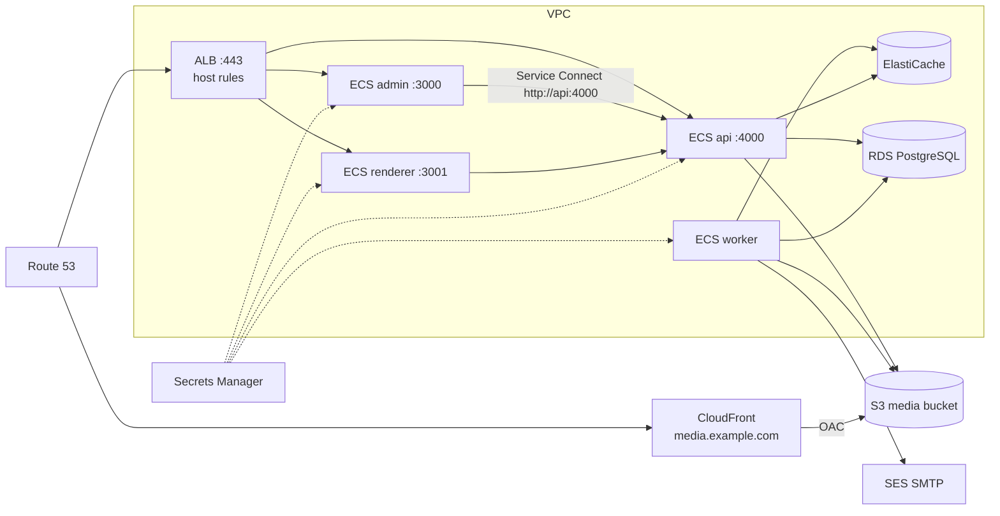

# AWS

**When to choose this:** production on AWS with managed data services and no servers to patch.

| Component            | AWS service                                                                    |
| -------------------- | ------------------------------------------------------------------------------ |
| api, renderer, admin | ECS on Fargate, behind an Application Load Balancer (ACM certificates)         |
| worker               | ECS on Fargate service without a load balancer (long-running BullMQ consumers) |
| migrations           | one-off ECS task `atrium-migrate` per release                                  |
| PostgreSQL 17        | Amazon RDS for PostgreSQL (or Aurora PostgreSQL)                               |
| Redis 7              | ElastiCache for Redis/Valkey, `maxmemory-policy noeviction`, TLS               |
| object storage       | S3 (private) + CloudFront with Origin Access Control on `media.example.com`    |
| email                | Amazon SES SMTP interface                                                      |
| secrets              | Secrets Manager (one JSON secret)                                              |
| DNS                  | Route 53                                                                       |



Alternatives: **App Runner** can host api/renderer/admin, but it scales on request load and throttles idle
instances, so the worker still needs an ECS service or EC2. **Lightsail** (one VM) works with the
[single-server guide](vps-podman.md).

## 0. Generate the artifacts

```bash
export AWS_REGION=us-east-1
ACCOUNT=$(aws sts get-caller-identity --query Account --output text)
pnpm atrium setup production --target aws --domain example.com \
  --registry $ACCOUNT.dkr.ecr.$AWS_REGION.amazonaws.com --tag 1.0.0
```

`deploy/aws/` contains `ecs/task-{api,worker,renderer,admin,migrate}.json` (Fargate task definitions with
`secrets` mapped from Secrets Manager JSON keys, `awslogs`, health checks), `iam/` policies, `deploy.sh`
(the CLI steps below, scripted) and `.env` with generated secrets.

## 1. Network

Use a VPC with two public subnets (ALB) and two private subnets (tasks, RDS, ElastiCache) with a NAT
gateway (tasks pull images and call SMTP/AI/Vercel APIs). Security groups:

| Group      | Inbound                                                                          |
| ---------- | -------------------------------------------------------------------------------- |
| `alb-sg`   | 80, 443 from 0.0.0.0/0                                                           |
| `app-sg`   | 3000, 3001, 4000 from `alb-sg`; all ports from `app-sg` itself (Service Connect) |
| `db-sg`    | 5432 from `app-sg`                                                               |
| `cache-sg` | 6379 from `app-sg`                                                               |

## 2. Images (ECR)

```bash
for r in api worker renderer admin migrate; do aws ecr create-repository --repository-name atrium-$r --image-scanning-configuration scanOnPush=true; done
aws ecr get-login-password | docker login --username AWS --password-stdin $ACCOUNT.dkr.ecr.$AWS_REGION.amazonaws.com
REG=$ACCOUNT.dkr.ecr.$AWS_REGION.amazonaws.com
docker build -f infra/containers/api.Containerfile -t $REG/atrium-api:1.0.0 .
docker build -f infra/containers/api.Containerfile --target migrate -t $REG/atrium-migrate:1.0.0 .
docker build -f infra/containers/worker.Containerfile -t $REG/atrium-worker:1.0.0 .
docker build -f infra/containers/renderer.Containerfile -t $REG/atrium-renderer:1.0.0 .
docker build -f infra/containers/admin.Containerfile --build-arg ATRIUM_API_INTERNAL_URL=http://api:4000 -t $REG/atrium-admin:1.0.0 .
for r in api worker renderer admin migrate; do docker push $REG/atrium-$r:1.0.0; done
```

The admin bakes `ATRIUM_API_INTERNAL_URL` into its `/api/*` rewrite at build time; `http://api:4000` is
the Service Connect alias created below. CI can push instead of GHCR by changing the `images` job.

## 3. Data services

```bash
# PostgreSQL 17 (Multi-AZ for production)
aws rds create-db-subnet-group --db-subnet-group-name atrium --db-subnet-group-description atrium --subnet-ids subnet-priv-a subnet-priv-b
aws rds create-db-instance --db-instance-identifier atrium --engine postgres --engine-version 17 \
  --db-instance-class db.t4g.medium --allocated-storage 50 --storage-type gp3 --multi-az \
  --master-username atrium --manage-master-user-password --db-name atrium \
  --db-subnet-group-name atrium --vpc-security-group-ids sg-db --backup-retention-period 14 \
  --storage-encrypted --deletion-protection --no-publicly-accessible

# Redis with noeviction (required by BullMQ) and TLS
aws elasticache create-cache-parameter-group --cache-parameter-group-name atrium-redis7 --cache-parameter-group-family redis7 --description atrium
aws elasticache modify-cache-parameter-group --cache-parameter-group-name atrium-redis7 --parameter-name-values ParameterName=maxmemory-policy,ParameterValue=noeviction
aws elasticache create-cache-subnet-group --cache-subnet-group-name atrium --cache-subnet-group-description atrium --subnet-ids subnet-priv-a subnet-priv-b
aws elasticache create-replication-group --replication-group-id atrium --replication-group-description atrium \
  --engine redis --engine-version 7.1 --cache-node-type cache.t4g.small --num-cache-clusters 2 --automatic-failover-enabled \
  --cache-parameter-group-name atrium-redis7 --cache-subnet-group-name atrium --security-group-ids sg-cache \
  --transit-encryption-enabled --at-rest-encryption-enabled
```

Connection strings for `.env`:

```dotenv
DATABASE_URL=postgresql://atrium:<password>@atrium.xxxx.us-east-1.rds.amazonaws.com:5432/atrium?sslmode=require
REDIS_URL=rediss://<primary-endpoint>:6379
```

## 4. Media bucket + CloudFront

```bash
BUCKET=atrium-media-$ACCOUNT
aws s3api create-bucket --bucket $BUCKET --region $AWS_REGION   # add --create-bucket-configuration LocationConstraint=$AWS_REGION outside us-east-1
aws s3api put-public-access-block --bucket $BUCKET --public-access-block-configuration BlockPublicAcls=true,IgnorePublicAcls=true,BlockPublicPolicy=true,RestrictPublicBuckets=true
aws s3api put-bucket-encryption --bucket $BUCKET --server-side-encryption-configuration '{"Rules":[{"ApplyServerSideEncryptionByDefault":{"SSEAlgorithm":"AES256"}}]}'
```

Create a CloudFront distribution with the bucket as origin, an Origin Access Control, an ACM certificate
for `media.example.com` (in us-east-1) and the alias `media.example.com`, then add the bucket policy
CloudFront shows (allow `s3:GetObject` to `cloudfront.amazonaws.com` with `AWS:SourceArn` = the
distribution). Set:

```dotenv
STORAGE_DRIVER=s3
S3_REGION=us-east-1
S3_BUCKET=atrium-media-<account>
S3_PUBLIC_URL=https://media.example.com
S3_FORCE_PATH_STYLE=false
# S3_ENDPOINT, S3_ACCESS_KEY_ID, S3_SECRET_ACCESS_KEY: leave empty to use the task role (preferred)
```

Least-privilege policy for the task role (`iam/s3-media-policy.json`):

```json
{
  "Version": "2012-10-17",
  "Statement": [
    {
      "Sid": "ListMediaBucket",
      "Effect": "Allow",
      "Action": ["s3:ListBucket", "s3:GetBucketLocation"],
      "Resource": "arn:aws:s3:::atrium-media-ACCOUNT"
    },
    {
      "Sid": "ReadWriteMediaObjects",
      "Effect": "Allow",
      "Action": [
        "s3:GetObject",
        "s3:PutObject",
        "s3:DeleteObject",
        "s3:AbortMultipartUpload",
        "s3:ListMultipartUploadParts"
      ],
      "Resource": "arn:aws:s3:::atrium-media-ACCOUNT/*"
    }
  ]
}
```

Organizations can still configure their own buckets as storage providers in the admin.

## 5. Email (SES)

Verify the sending domain in SES (DKIM CNAMEs + a custom MAIL FROM domain), request production access,
and create SMTP credentials (IAM user with `ses:SendRawEmail`):

```dotenv
SMTP_HOST=email-smtp.us-east-1.amazonaws.com
SMTP_PORT=587
SMTP_SECURE=false
SMTP_USER=<SMTP username>
SMTP_PASSWORD=<SMTP password>
MAIL_FROM=Atrium <no-reply@example.com>
```

## 6. Secrets

`deploy.sh` turns the secret keys of `.env` into one JSON secret `atrium/production`; task definitions
reference keys as `arn:aws:secretsmanager:REGION:ACCOUNT:secret:atrium/production:JWT_ACCESS_SECRET::`.

```bash
aws secretsmanager create-secret --name atrium/production --secret-string file://secret.json
```

Required keys: `DATABASE_URL`, `REDIS_URL`, `JWT_ACCESS_SECRET`, `JWT_REFRESH_SECRET`, `ENCRYPTION_KEY`
(32 bytes, base64), `RENDERER_SECRET`, `ANALYTICS_SALT`; optional `SMTP_*`, `S3_*` keys,
`ANTHROPIC_API_KEY`, `OPENAI_API_KEY`, `GEMINI_API_KEY`, `VERCEL_TOKEN`. Non-secret settings are plain
`environment` entries in the task definitions — edit them there (domains, `S3_BUCKET`, `SMTP_HOST`…).

## 7. IAM roles

```bash
aws iam create-role --role-name atrium-ecs-execution --assume-role-policy-document file://iam/ecs-tasks-trust.json
aws iam attach-role-policy --role-name atrium-ecs-execution --policy-arn arn:aws:iam::aws:policy/service-role/AmazonECSTaskExecutionRolePolicy
aws iam put-role-policy --role-name atrium-ecs-execution --policy-name atrium-secrets-logs --policy-document file://iam/ecs-execution-extra-policy.json
aws iam create-role --role-name atrium-ecs-task --assume-role-policy-document file://iam/ecs-tasks-trust.json
aws iam put-role-policy --role-name atrium-ecs-task --policy-name atrium-s3-media --policy-document file://iam/s3-media-policy.json
```

The execution role pulls images, reads `atrium/production` and writes logs; the task role only touches the
media bucket.

## 8. Cluster, task definitions and migrations

```bash
aws ecs create-cluster --cluster-name atrium --service-connect-defaults namespace=atrium
for t in api worker renderer admin migrate; do aws ecs register-task-definition --cli-input-json file://ecs/task-$t.json; done
aws ecs run-task --cluster atrium --launch-type FARGATE --task-definition atrium-migrate \
  --network-configuration "awsvpcConfiguration={subnets=[subnet-priv-a,subnet-priv-b],securityGroups=[sg-app],assignPublicIp=DISABLED}"
```

Seed once from a machine that can reach RDS (bastion, SSM port forwarding, or a temporary task built from
a checkout): `DATABASE_URL=... pnpm db:seed`.

## 9. Load balancer and services

1. Request an ACM certificate (same region as the ALB) for `admin.example.com`, `api.example.com`,
   `sites.example.com`, `*.sites.example.com` (DNS validation in Route 53).
2. Create target groups (type `ip`): `atrium-api` (4000, health `/v1/health`), `atrium-admin` (3000,
   health `/`, success codes `200-399`), `atrium-renderer` (3001, health `/`, success codes `200-404` —
   unknown hosts legitimately return 404).
3. ALB listener 443 with host rules: `api.example.com` → api, `admin.example.com` → admin, default
   action → renderer (covers `sites.example.com`, `*.sites.example.com` and customer domains). Listener
   80 redirects to 443. Raise the idle timeout to 120 s (AI progress uses Server-Sent Events).
4. Services:

```bash
SUBNETS=subnet-priv-a,subnet-priv-b
for svc in api renderer admin; do
  case $svc in api) port=4000;; renderer) port=3001;; admin) port=3000;; esac
  aws ecs create-service --cluster atrium --service-name atrium-$svc --task-definition atrium-$svc --desired-count 2 \
    --launch-type FARGATE --network-configuration "awsvpcConfiguration={subnets=[$SUBNETS],securityGroups=[sg-app]}" \
    --load-balancers targetGroupArn=<tg-arn-$svc>,containerName=$svc,containerPort=$port \
    --deployment-configuration "minimumHealthyPercent=100,maximumPercent=200,deploymentCircuitBreaker={enable=true,rollback=true}" \
    --service-connect-configuration "enabled=true,namespace=atrium$( [ $svc = api ] && echo ',services=[{portName=api,clientAliases=[{port=4000,dnsName=api}]}]')"
done
aws ecs create-service --cluster atrium --service-name atrium-worker --task-definition atrium-worker --desired-count 2 \
  --launch-type FARGATE --network-configuration "awsvpcConfiguration={subnets=[$SUBNETS],securityGroups=[sg-app]}" \
  --service-connect-configuration "enabled=true,namespace=atrium"
```

5. Route 53: alias A records for the four hosts → ALB; `media.example.com` → CloudFront.

**Custom domains.** Tenants point their domain (CNAME) at `sites.example.com`. The ALB needs a certificate
for each one: add ACM certificates to the listener (SNI; default quota 25 per ALB, raisable), or put
CloudFront in front of the renderer with per-domain certificates, or run Caddy as a small ECS service
in front of the renderer for on-demand TLS (`infra/caddy/Caddyfile`, ask endpoint
`/v1/public/domains/check`).

## 10. Auto scaling

```bash
aws application-autoscaling register-scalable-target --service-namespace ecs --resource-id service/atrium/atrium-api \
  --scalable-dimension ecs:service:DesiredCount --min-capacity 2 --max-capacity 10
aws application-autoscaling put-scaling-policy --service-namespace ecs --resource-id service/atrium/atrium-api \
  --scalable-dimension ecs:service:DesiredCount --policy-name cpu70 --policy-type TargetTrackingScaling \
  --target-tracking-scaling-policy-configuration '{"TargetValue":70,"PredefinedMetricSpecification":{"PredefinedMetricType":"ECSServiceAverageCPUUtilization"}}'
```

Repeat for the renderer. Scale the worker on CPU, or on queue depth by publishing a CloudWatch metric from
the BullMQ wait lists (`LLEN atrium:<queue>:wait`). Each renderer task has its own ISR cache and the API
revalidates `RENDERER_URL` (through the ALB, so one task); keep renderer counts modest or add a shared
Next.js cache handler before scaling it widely.

## Releases

```bash
# push new images, then:
aws ecs run-task --cluster atrium --launch-type FARGATE --task-definition atrium-migrate --network-configuration ...   # wait for exit code 0
for s in api worker renderer admin; do aws ecs update-service --cluster atrium --service atrium-$s --force-new-deployment; done
aws ecs wait services-stable --cluster atrium --services atrium-api atrium-worker atrium-renderer atrium-admin
```

`.github/workflows/deploy-containers.yml` (`target: ecs`, OIDC role) automates this. Keep migrations
backward compatible (expand → migrate data → contract in a later release) because old tasks keep serving
while new ones start. The circuit breaker rolls back a failed deployment.

## Backups

- RDS automated backups with point-in-time recovery (14+ days) and snapshots before major releases.
- A logical dump for portability: `atrium backup` from a bastion, or an ECS scheduled task running
  `pg_dump | gzip | aws s3 cp - s3://atrium-backups/...` (see `infra/k8s/base/backup-cronjob.yaml` for the
  commands).
- S3 versioning + lifecycle rules on the media bucket; cross-region replication if required.

## Observability

Logs go to CloudWatch log groups `/atrium/<service>` (JSON lines from pino). Alarms worth having: ALB 5xx,
target health, RDS CPU/free storage/connections, ElastiCache memory and evictions (must stay 0),
`atrium-worker` running count, and failed jobs (`atrium status` or the admin Jobs page).

## Troubleshooting

| Symptom                                       | Fix                                                                                                                                                |
| --------------------------------------------- | -------------------------------------------------------------------------------------------------------------------------------------------------- |
| Tasks stop with `ResourceInitializationError` | execution role cannot read `atrium/production` or pull from ECR; private subnets need NAT or VPC endpoints                                         |
| api unhealthy                                 | `/v1/health/ready` checks PostgreSQL and Redis — security groups, `sslmode=require`, `rediss://`                                                   |
| Admin shows API errors                        | the admin image was built with the wrong `ATRIUM_API_INTERNAL_URL`; rebuild with `http://api:4000` and enable Service Connect on the admin service |
| Renderer target group flaps                   | health check success codes must include 404                                                                                                        |
| Jobs lost after Redis restarts                | parameter group must set `maxmemory-policy noeviction`                                                                                             |
| Provider credentials cannot be decrypted      | `ENCRYPTION_KEY` differs between services or changed; it must be the same 32-byte base64 value everywhere                                          |
| Login fails in the browser                    | `COOKIE_DOMAIN=admin.example.com`, `CORS_ORIGINS=https://admin.example.com`, URLs use https                                                        |
