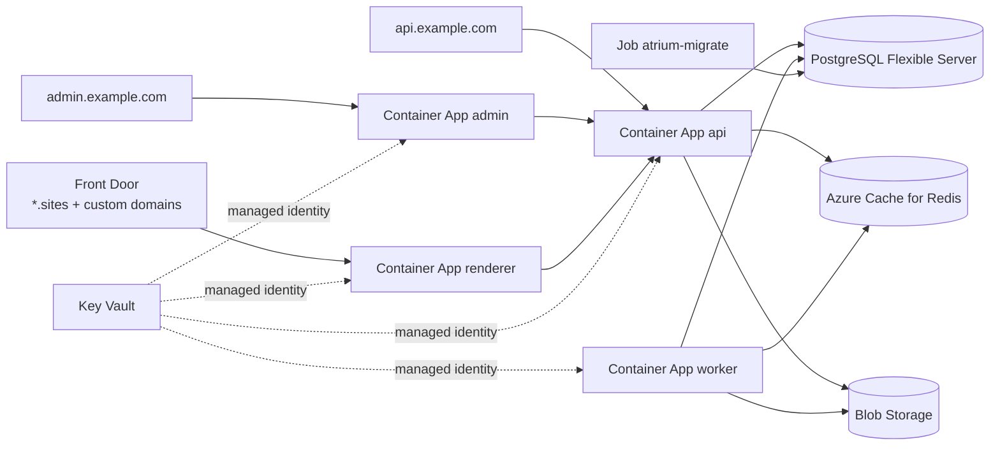

# Azure

**When to choose this:** production on Azure with managed services and no VMs.

| Component             | Azure service                                                                                    |
| --------------------- | ------------------------------------------------------------------------------------------------ |
| api, renderer, admin  | Azure Container Apps with external ingress and managed certificates                              |
| worker                | Container App without ingress, `minReplicas >= 1` (never scale to zero — it is a queue consumer) |
| migrations            | Container Apps **Job** (manual trigger, once per release)                                        |
| PostgreSQL 17         | Azure Database for PostgreSQL – Flexible Server                                                  |
| Redis                 | Azure Cache for Redis (`maxmemory-policy noeviction`)                                            |
| object storage        | Blob Storage through the `azure-blob` driver (optionally Front Door/CDN on `media.example.com`)  |
| secrets               | Key Vault, referenced by Container Apps through a managed identity                               |
| email                 | Azure Communication Services Email (SMTP) or SendGrid/Postmark                                   |
| edge for tenant sites | Front Door (wildcard + customer domains with managed certificates) → renderer                    |



## 0. Generate the artifacts

```bash
pnpm atrium setup production --target azure --domain example.com --registry myacr.azurecr.io/atrium --tag 1.0.0
```

`deploy/azure/` contains `deploy.sh` (the steps below, scripted) and `.env` with generated secrets.

## 1. Resource group, registry, images

```bash
RG=atrium-prod; LOC=westeurope
az group create -n $RG -l $LOC
az acr create -g $RG -n myacr --sku Standard
az acr login -n myacr
REG=myacr.azurecr.io/atrium
docker build -f infra/containers/api.Containerfile -t $REG/atrium-api:1.0.0 .
docker build -f infra/containers/api.Containerfile --target migrate -t $REG/atrium-migrate:1.0.0 .
docker build -f infra/containers/worker.Containerfile -t $REG/atrium-worker:1.0.0 .
docker build -f infra/containers/renderer.Containerfile -t $REG/atrium-renderer:1.0.0 .
docker build -f infra/containers/admin.Containerfile --build-arg ATRIUM_API_INTERNAL_URL=http://atrium-api -t $REG/atrium-admin:1.0.0 .
for r in api migrate worker renderer admin; do docker push $REG/atrium-$r:1.0.0; done
```

Inside a Container Apps environment, apps reach each other by name over internal ingress
(`http://atrium-api`), which is what the admin's build-time `ATRIUM_API_INTERNAL_URL` uses.

## 2. Data services

```bash
az postgres flexible-server create -g $RG -n atrium-pg -l $LOC --version 17 \
  --tier GeneralPurpose --sku-name Standard_D2ds_v5 --storage-size 128 --high-availability ZoneRedundant \
  --admin-user atrium --admin-password "$(openssl rand -hex 24)" --vnet atrium-vnet --subnet db
az postgres flexible-server db create -g $RG -s atrium-pg -d atrium

az redis create -g $RG -n atrium-redis -l $LOC --sku Standard --vm-size c1 \
  --redis-configuration '{"maxmemory-policy":"noeviction"}'

az storage account create -g $RG -n atriummedia -l $LOC --sku Standard_ZRS --kind StorageV2 --min-tls-version TLS1_2 --allow-blob-public-access true
az storage container create --account-name atriummedia -n atrium-media --public-access blob
```

Settings in `.env`:

```dotenv
DATABASE_URL=postgresql://atrium:<password>@atrium-pg.postgres.database.azure.com:5432/atrium?sslmode=require
REDIS_URL=rediss://:<access-key>@atrium-redis.redis.cache.windows.net:6380
STORAGE_DRIVER=azure-blob
AZURE_STORAGE_ACCOUNT=atriummedia
AZURE_STORAGE_CONTAINER=atrium-media
AZURE_STORAGE_KEY=<account key>
```

Azure Cache for Redis serves TLS on port 6380. The `azure-blob` driver is documented in
[STORAGE.md](../STORAGE.md); for a CDN, put Front Door or Azure CDN in front of the container and use that
URL as the public base.

## 3. Key Vault and identity

```bash
az keyvault create -g $RG -n atrium-kv -l $LOC --enable-rbac-authorization true
az identity create -g $RG -n atrium-id
ID=$(az identity show -g $RG -n atrium-id --query id -o tsv)
PRINCIPAL=$(az identity show -g $RG -n atrium-id --query principalId -o tsv)
az role assignment create --assignee $PRINCIPAL --role "Key Vault Secrets User" --scope $(az keyvault show -n atrium-kv --query id -o tsv)
az role assignment create --assignee $PRINCIPAL --role AcrPull --scope $(az acr show -n myacr --query id -o tsv)
# one Key Vault secret per sensitive key (names use dashes)
az keyvault secret set --vault-name atrium-kv -n database-url --value "$DATABASE_URL"
az keyvault secret set --vault-name atrium-kv -n jwt-access-secret --value "$JWT_ACCESS_SECRET"
# … jwt-refresh-secret, encryption-key, renderer-secret, analytics-salt, redis-url, azure-storage-key, smtp-password, ai keys
```

`deploy.sh` loops over the secret keys of `.env` for you.

## 4. Container Apps environment, migrations and apps

```bash
az extension add --name containerapp --upgrade
az containerapp env create -g $RG -n atrium-env -l $LOC --infrastructure-subnet-resource-id <subnet-id>

KV=https://atrium-kv.vault.azure.net/secrets
SECRETS="database-url=keyvaultref:$KV/database-url,identityref:$ID jwt-access-secret=keyvaultref:$KV/jwt-access-secret,identityref:$ID ..."
ENVV="NODE_ENV=production ADMIN_URL=https://admin.example.com API_URL=https://api.example.com RENDERER_URL=https://sites.example.com \
  PLATFORM_SITES_DOMAIN=sites.example.com PREVIEW_URL=https://sites.example.com CORS_ORIGINS=https://admin.example.com \
  COOKIE_DOMAIN=admin.example.com STORAGE_DRIVER=azure-blob AZURE_STORAGE_ACCOUNT=atriummedia AZURE_STORAGE_CONTAINER=atrium-media \
  DATABASE_URL=secretref:database-url JWT_ACCESS_SECRET=secretref:jwt-access-secret ..."

az containerapp job create -g $RG -n atrium-migrate --environment atrium-env --trigger-type Manual \
  --replica-timeout 900 --replica-retry-limit 1 --image $REG/atrium-migrate:1.0.0 --cpu 0.5 --memory 1Gi \
  --registry-server myacr.azurecr.io --registry-identity $ID --user-assigned $ID --secrets $SECRETS --env-vars $ENVV
az containerapp job start -g $RG -n atrium-migrate

az containerapp create -g $RG -n atrium-api --environment atrium-env --image $REG/atrium-api:1.0.0 \
  --ingress external --target-port 4000 --min-replicas 2 --max-replicas 10 --cpu 1 --memory 2Gi \
  --registry-server myacr.azurecr.io --registry-identity $ID --user-assigned $ID --secrets $SECRETS --env-vars $ENVV PORT=4000
az containerapp create -g $RG -n atrium-worker --environment atrium-env --image $REG/atrium-worker:1.0.0 \
  --min-replicas 1 --max-replicas 5 --cpu 1 --memory 2Gi \
  --registry-server myacr.azurecr.io --registry-identity $ID --user-assigned $ID --secrets $SECRETS --env-vars $ENVV
az containerapp create -g $RG -n atrium-renderer --environment atrium-env --image $REG/atrium-renderer:1.0.0 \
  --ingress external --target-port 3001 --min-replicas 2 --max-replicas 10 --cpu 0.5 --memory 1Gi \
  --registry-server myacr.azurecr.io --registry-identity $ID --user-assigned $ID --secrets $SECRETS --env-vars $ENVV PORT=3001 ATRIUM_API_INTERNAL_URL=http://atrium-api
az containerapp create -g $RG -n atrium-admin --environment atrium-env --image $REG/atrium-admin:1.0.0 \
  --ingress external --target-port 3000 --min-replicas 1 --max-replicas 5 --cpu 0.5 --memory 1Gi \
  --registry-server myacr.azurecr.io --registry-identity $ID --user-assigned $ID --secrets $SECRETS --env-vars $ENVV PORT=3000
```

Health probes: configure the api's liveness probe on `/v1/health` and readiness on `/v1/health/ready`
(YAML `probes` via `az containerapp update --yaml`). For the renderer use TCP probes — unknown hosts return 404.

Seed once from a machine with network access to the database: `DATABASE_URL=... pnpm db:seed`.

## 5. Domains and certificates

```bash
for pair in "atrium-api api.example.com" "atrium-admin admin.example.com" "atrium-renderer sites.example.com"; do
  set -- $pair
  az containerapp hostname add -g $RG -n $1 --hostname $2
  az containerapp hostname bind -g $RG -n $1 --hostname $2 --environment atrium-env --validation-method CNAME
done
```

Managed certificates do not cover wildcards. For `*.sites.example.com` and customer domains put
**Azure Front Door** (Standard/Premium) in front of the renderer: a wildcard custom domain with your own
certificate from Key Vault, plus one Front Door custom domain per verified customer domain (Front Door
manages those certificates). Origin: the renderer's Container Apps FQDN, forwarding the original Host
header so the renderer can resolve the site.

## Releases

```bash
az containerapp job update -g $RG -n atrium-migrate --image $REG/atrium-migrate:1.1.0
az containerapp job start -g $RG -n atrium-migrate      # wait: az containerapp job execution list
for a in api worker renderer admin; do az containerapp update -g $RG -n atrium-$a --image $REG/atrium-$a:1.1.0; done
```

Container Apps creates a new revision and shifts traffic when it is healthy. Keep migrations
backward compatible (expand → migrate → contract) because old revisions serve during the rollout.

## Backups

Flexible Server keeps automated backups with point-in-time restore (7–35 days, geo-redundant optional).
Add a logical dump for portability (`atrium backup` from a jump host, or a scheduled Container Apps Job
running `pg_dump | gzip` to Blob Storage). Enable soft delete and versioning on the storage account.

## Scaling notes

The worker can scale on queue depth with a KEDA `redis` scaler on `atrium:<queue>:wait`. Each renderer
replica keeps its own ISR cache and the API revalidates `RENDERER_URL` once; keep renderer replicas low or
add a shared cache handler.

## Troubleshooting

| Symptom                                           | Fix                                                                                                         |
| ------------------------------------------------- | ----------------------------------------------------------------------------------------------------------- |
| Revision fails to provision with Key Vault errors | the managed identity needs _Key Vault Secrets User_; secret URIs must not include a version unless intended |
| api not ready                                     | PostgreSQL firewall/VNet integration, `sslmode=require`, Redis on 6380 with `rediss://`                     |
| Jobs disappear                                    | Redis `maxmemory-policy` must be `noeviction`                                                               |
| Admin cannot reach the API                        | admin image built with the wrong `ATRIUM_API_INTERNAL_URL`; rebuild with `http://atrium-api`                |
| Tenant sites show the wrong site                  | Front Door must forward the client Host header to the renderer                                              |
| Worker scaled to zero                             | set `--min-replicas 1`; queue consumers must stay running                                                   |
