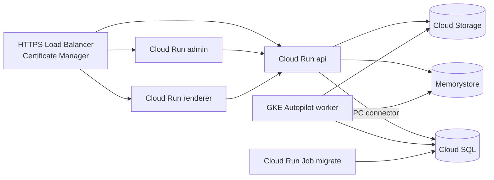

# Google Cloud

**When to choose this:** production on GCP with managed data services.

| Component            | GCP service                                                                       |
| -------------------- | --------------------------------------------------------------------------------- |
| api, renderer, admin | Cloud Run services (min instances ≥ 1 for api and renderer)                       |
| worker               | **GKE Autopilot** Deployment, or a Compute Engine VM running the container        |
| migrations           | Cloud Run Job `atrium-migrate`                                                    |
| PostgreSQL 17        | Cloud SQL for PostgreSQL (private IP)                                             |
| Redis                | Memorystore for Redis (`maxmemory-policy=noeviction`)                             |
| object storage       | Cloud Storage through its S3-compatible XML API (HMAC keys)                       |
| secrets              | Secret Manager                                                                    |
| edge                 | global external Application Load Balancer + serverless NEGs + Certificate Manager |

### Why the worker is not on Cloud Run

The worker is a set of BullMQ consumers holding open Redis connections and pulling jobs continuously.
Cloud Run services are request-driven: without incoming requests, CPU is throttled (unless you pay for
"CPU always allocated"), autoscaling reacts to HTTP concurrency rather than queue depth, and instances are
recycled. Cloud Run Jobs run tasks to completion with timeouts; they suit migrations, not persistent
consumers. GKE Autopilot or a small VM gives the worker a normal long-running process. (Running the
whole stack on GKE with `infra/k8s` is also an option — see [kubernetes.md](kubernetes.md).)



## 0. Generate the artifacts

```bash
pnpm atrium setup production --target gcp --domain example.com \
  --registry europe-west1-docker.pkg.dev/<project>/atrium --tag 1.0.0
```

`deploy/gcp/` contains `deploy.sh` (the steps below), `worker-gke.yaml` and `.env`.

## 1. Project, registry, images

```bash
PROJECT=my-project; REGION=europe-west1
gcloud config set project $PROJECT
gcloud services enable run.googleapis.com sqladmin.googleapis.com redis.googleapis.com secretmanager.googleapis.com \
  vpcaccess.googleapis.com artifactregistry.googleapis.com container.googleapis.com
gcloud artifacts repositories create atrium --repository-format=docker --location=$REGION
gcloud auth configure-docker $REGION-docker.pkg.dev
REG=$REGION-docker.pkg.dev/$PROJECT/atrium
docker build -f infra/containers/api.Containerfile -t $REG/atrium-api:1.0.0 .
docker build -f infra/containers/api.Containerfile --target migrate -t $REG/atrium-migrate:1.0.0 .
docker build -f infra/containers/worker.Containerfile -t $REG/atrium-worker:1.0.0 .
docker build -f infra/containers/renderer.Containerfile -t $REG/atrium-renderer:1.0.0 .
docker build -f infra/containers/admin.Containerfile --build-arg ATRIUM_API_INTERNAL_URL=https://api.example.com -t $REG/atrium-admin:1.0.0 .
for r in api migrate worker renderer admin; do docker push $REG/atrium-$r:1.0.0; done
```

Cloud Run services talk to each other over HTTPS URLs, so the admin's build-time
`ATRIUM_API_INTERNAL_URL` is the public API URL (or the api's `*.run.app` URL).

## 2. Data services

```bash
gcloud compute addresses create google-managed-services-default --global --purpose=VPC_PEERING --prefix-length=16 --network=default
gcloud services vpc-peerings connect --service=servicenetworking.googleapis.com --ranges=google-managed-services-default --network=default
gcloud sql instances create atrium-pg --database-version=POSTGRES_17 --region=$REGION --tier=db-custom-2-7680 \
  --availability-type=REGIONAL --no-assign-ip --network=default --backup-start-time=03:00 --enable-point-in-time-recovery
gcloud sql databases create atrium --instance=atrium-pg
gcloud sql users create atrium --instance=atrium-pg --password="$(openssl rand -hex 24)"

gcloud redis instances create atrium-redis --region=$REGION --size=1 --redis-version=redis_7_2 \
  --redis-config maxmemory-policy=noeviction --transit-encryption-mode=SERVER_AUTHENTICATION

gcloud storage buckets create gs://atrium-media-$PROJECT --location=$REGION --uniform-bucket-level-access
gcloud storage buckets add-iam-policy-binding gs://atrium-media-$PROJECT --member=allUsers --role=roles/storage.objectViewer   # public media
gcloud iam service-accounts create atrium-media
gcloud storage buckets add-iam-policy-binding gs://atrium-media-$PROJECT --member=serviceAccount:atrium-media@$PROJECT.iam.gserviceaccount.com --role=roles/storage.objectAdmin
gcloud storage hmac create atrium-media@$PROJECT.iam.gserviceaccount.com   # prints accessId + secret
```

Settings:

```dotenv
DATABASE_URL=postgresql://atrium:<password>@<cloud-sql-private-ip>:5432/atrium
REDIS_URL=rediss://<memorystore-ip>:6378          # TLS port for SERVER_AUTHENTICATION
STORAGE_DRIVER=s3
S3_ENDPOINT=https://storage.googleapis.com
S3_REGION=auto
S3_BUCKET=atrium-media-<project>
S3_FORCE_PATH_STYLE=true
S3_ACCESS_KEY_ID=<HMAC accessId>
S3_SECRET_ACCESS_KEY=<HMAC secret>
S3_PUBLIC_URL=https://storage.googleapis.com/atrium-media-<project>
```

With Memorystore in-transit encryption the client must trust the instance CA; if your Redis client setup
does not, use `--transit-encryption-mode=DISABLED` on the private network and `redis://<ip>:6379`.

## 3. Secrets and network

```bash
gcloud compute networks vpc-access connectors create atrium-conn --region=$REGION --range=10.8.0.0/28
for k in DATABASE_URL REDIS_URL JWT_ACCESS_SECRET JWT_REFRESH_SECRET ENCRYPTION_KEY RENDERER_SECRET ANALYTICS_SALT S3_ACCESS_KEY_ID S3_SECRET_ACCESS_KEY; do
  printf '%s' "${!k}" | gcloud secrets create atrium-$k --data-file=-
done
```

Grant the Cloud Run runtime service account `roles/secretmanager.secretAccessor`.

## 4. Migrations, services and worker

```bash
SECRETS="DATABASE_URL=atrium-DATABASE_URL:latest,REDIS_URL=atrium-REDIS_URL:latest,JWT_ACCESS_SECRET=atrium-JWT_ACCESS_SECRET:latest,JWT_REFRESH_SECRET=atrium-JWT_REFRESH_SECRET:latest,ENCRYPTION_KEY=atrium-ENCRYPTION_KEY:latest,RENDERER_SECRET=atrium-RENDERER_SECRET:latest,ANALYTICS_SALT=atrium-ANALYTICS_SALT:latest,S3_ACCESS_KEY_ID=atrium-S3_ACCESS_KEY_ID:latest,S3_SECRET_ACCESS_KEY=atrium-S3_SECRET_ACCESS_KEY:latest"
ENVV="NODE_ENV=production,ADMIN_URL=https://admin.example.com,API_URL=https://api.example.com,RENDERER_URL=https://sites.example.com,PLATFORM_SITES_DOMAIN=sites.example.com,PREVIEW_URL=https://sites.example.com,CORS_ORIGINS=https://admin.example.com,COOKIE_DOMAIN=admin.example.com,STORAGE_DRIVER=s3,S3_ENDPOINT=https://storage.googleapis.com,S3_REGION=auto,S3_BUCKET=atrium-media-$PROJECT,S3_FORCE_PATH_STYLE=true"

gcloud run jobs deploy atrium-migrate --image=$REG/atrium-migrate:1.0.0 --region=$REGION --vpc-connector=atrium-conn \
  --set-env-vars="$ENVV" --set-secrets="$SECRETS" --max-retries=1 --task-timeout=900s
gcloud run jobs execute atrium-migrate --region=$REGION --wait

gcloud run deploy atrium-api --image=$REG/atrium-api:1.0.0 --region=$REGION --port=4000 --min-instances=1 --max-instances=10 \
  --cpu=1 --memory=1Gi --vpc-connector=atrium-conn --set-env-vars="$ENVV,PORT=4000" --set-secrets="$SECRETS" --allow-unauthenticated
gcloud run deploy atrium-renderer --image=$REG/atrium-renderer:1.0.0 --region=$REGION --port=3001 --min-instances=1 --max-instances=20 \
  --memory=1Gi --set-env-vars="$ENVV,ATRIUM_API_INTERNAL_URL=https://api.example.com" --set-secrets="RENDERER_SECRET=atrium-RENDERER_SECRET:latest,ANALYTICS_SALT=atrium-ANALYTICS_SALT:latest" --allow-unauthenticated
gcloud run deploy atrium-admin --image=$REG/atrium-admin:1.0.0 --region=$REGION --port=3000 --min-instances=0 --max-instances=5 \
  --memory=1Gi --set-env-vars="$ENVV" --allow-unauthenticated
```

Worker on GKE Autopilot (`deploy/gcp/worker-gke.yaml`):

```bash
gcloud container clusters create-auto atrium --region=$REGION --network=default
gcloud container clusters get-credentials atrium --region=$REGION
kubectl create secret generic atrium-secrets --from-env-file=.env
kubectl apply -f worker-gke.yaml
```

Or on a VM:

```bash
gcloud compute instances create-with-container atrium-worker --zone=$REGION-b --machine-type=e2-standard-2 \
  --container-image=$REG/atrium-worker:1.0.0 --container-env-file=.env --container-restart-policy=always --network=default
```

Seed once from a machine that can reach Cloud SQL (Cloud SQL Auth Proxy works well):
`cloud-sql-proxy $PROJECT:$REGION:atrium-pg --port 5433 --private-ip` then
`DATABASE_URL=postgresql://atrium:<pw>@localhost:5433/atrium pnpm db:seed`.

## 5. Load balancer and certificates

1. Serverless NEGs for the three Cloud Run services, one backend service each.
2. URL map with host rules: `api.example.com` → api, `admin.example.com` → admin, default → renderer
   (covers `sites.example.com`, `*.sites.example.com` and customer domains).
3. Certificate Manager: a certificate map with a DNS-authorized wildcard certificate for
   `*.sites.example.com` + `sites.example.com`, Google-managed certificates for admin/api, and an entry per
   verified customer domain (or use load-balancer authorization for each).
4. A global static IP and DNS records for every host.

Cloud Run's own domain mappings do not support wildcards, which is why the load balancer is used.

## Releases

```bash
gcloud run jobs update atrium-migrate --image=$REG/atrium-migrate:1.1.0 --region=$REGION
gcloud run jobs execute atrium-migrate --region=$REGION --wait
for s in api renderer admin; do gcloud run services update atrium-$s --image=$REG/atrium-$s:1.1.0 --region=$REGION; done
kubectl set image deploy/atrium-worker worker=$REG/atrium-worker:1.1.0
```

Cloud Run shifts traffic to the new revision once it is healthy; roll back with
`gcloud run services update-traffic atrium-api --to-revisions=<previous>=100`. Keep migrations
backward compatible (expand → migrate → contract).

## Backups

Cloud SQL automated backups + point-in-time recovery; export for portability with
`gcloud sql export sql atrium-pg gs://atrium-backups/atrium-$(date +%F).sql.gz --database=atrium` or
`atrium backup` through the proxy. Turn on object versioning for the media bucket.

## Troubleshooting

| Symptom                                   | Fix                                                                                                           |
| ----------------------------------------- | ------------------------------------------------------------------------------------------------------------- |
| api cannot reach Cloud SQL or Memorystore | the service needs the VPC connector (or Direct VPC egress) on the same network as the private IPs             |
| Uploads fail with `SignatureDoesNotMatch` | GCS interoperability needs `S3_REGION=auto`/`us-east-1` and path-style requests; use HMAC keys, not JSON keys |
| Worker not processing                     | it must run on GKE/VM, not Cloud Run; check Redis connectivity and the `noeviction` policy                    |
| Tenant sites return the admin             | URL map default must be the renderer; the LB must preserve the Host header (serverless NEGs do)               |
| Cold starts on first request              | raise `--min-instances` for api and renderer                                                                  |
