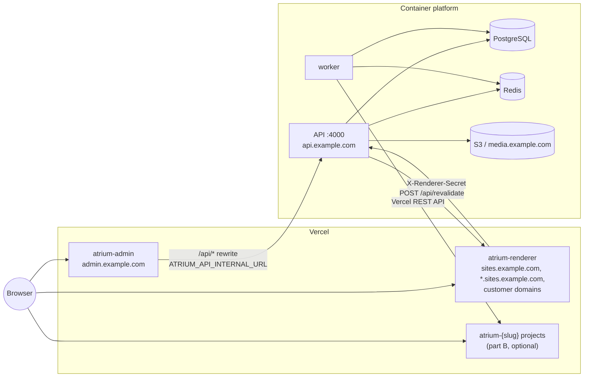
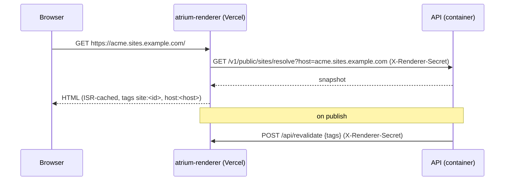
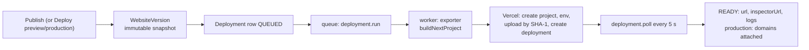
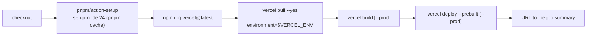

# Deploying with Vercel

Vercel can play two separate roles in an Atrium installation. You can use either one on its own or both together.

| Part | What runs on Vercel                                                                                               | Section                                                                    |
| ---- | ----------------------------------------------------------------------------------------------------------------- | -------------------------------------------------------------------------- |
| A    | The platform's own Next.js apps: `apps/admin` (admin and builder) and `apps/renderer` (multi-tenant public sites) | [A. Admin and renderer on Vercel](#a-admin-and-renderer-on-vercel)         |
| B    | One Vercel project per customer website, created and deployed by the worker through the Vercel provider           | [B. Independent per-site deployments](#b-independent-per-site-deployments) |
| C    | CI that builds and deploys part A from GitHub Actions                                                             | [C. GitHub Actions](#c-github-actions-deploy-verceliyml)                   |

The API and worker **never run on Vercel**. The worker is a long-running set of BullMQ consumers that uses sharp
and holds 10-minute job locks. The API is the BullMQ producer and serves SSE streams. Run both, with PostgreSQL,
Redis and object storage, on a container platform:

- [aws.md](aws.md) (ECS Fargate)
- [fly-railway-render.md](fly-railway-render.md)
- [vps-podman.md](vps-podman.md)
- [kubernetes.md](kubernetes.md)

Internals of the Vercel provider (API calls, state mapping, rollback semantics, limits and known gaps) are covered
in [../VERCEL.md](../VERCEL.md).



---

## A. Admin and renderer on Vercel

### A.0 Prerequisites

1. The API and worker are deployed, migrated (`pnpm db:deploy` or the `atrium-migrate` image) and reachable at
   `https://api.example.com`. Check `GET https://api.example.com/v1/health/ready`.
2. You have a Vercel team, and the Vercel CLI is installed (`npm i -g vercel`, then `vercel login`).
3. `example.com` is a domain you control. The tenant wildcard `*.sites.example.com` requires the domain's
   nameservers to point at Vercel (see [A.5](#a5-domains)).

### A.1 Generate the configuration

```bash
pnpm atrium setup production --target vercel --domain example.com
```

This writes `deploy/vercel/`:

| File                   | Purpose                                                                                         |
| ---------------------- | ----------------------------------------------------------------------------------------------- |
| `admin/vercel.json`    | Build settings for the admin project                                                            |
| `renderer/vercel.json` | Build settings for the renderer project                                                         |
| `env.admin`            | Environment variables for the admin project                                                     |
| `env.renderer`         | Environment variables for the renderer project                                                  |
| `.env`                 | Full environment for the API and worker on your container platform. Secrets are generated here. |
| `NEXT-STEPS.md`        | Checklist with your hostnames filled in                                                         |

It uses the standard hostnames: `admin.example.com`, `api.example.com`, `sites.example.com` with
`*.sites.example.com`, and `media.example.com`.

The generated `vercel.json` files (`packages/cli/templates/production/vercel/`) contain:

```jsonc
// admin/vercel.json
{
  "framework": "nextjs",
  "installCommand": "pnpm install --frozen-lockfile",
  "buildCommand": "cd ../.. && pnpm exec turbo run build --filter=@atrium/admin",
  "outputDirectory": ".next",
  "regions": ["iad1"],
  "headers": [{ "source": "/(.*)", "headers": [
    { "key": "X-Frame-Options", "value": "DENY" },
    { "key": "X-Content-Type-Options", "value": "nosniff" } ] }]
}
// renderer/vercel.json
{
  "framework": "nextjs",
  "installCommand": "pnpm install --frozen-lockfile",
  "buildCommand": "cd ../.. && pnpm exec turbo run build --filter=@atrium/renderer",
  "outputDirectory": ".next",
  "regions": ["iad1"]
}
```

Copy them into place, or enter the same values under **Project Settings, Build and Deployment**:

```bash
cp deploy/vercel/admin/vercel.json    apps/admin/vercel.json
cp deploy/vercel/renderer/vercel.json apps/renderer/vercel.json
```

Change `regions` to the Vercel region closest to your API and database. Every server render and every `/api/*`
call goes from Vercel to the API.

### A.2 Create two projects from the monorepo

Create both projects from the same Git repository, either by importing it in the dashboard or by running
`vercel link` inside each app folder:

| Setting                                                    | atrium-admin                                                   | atrium-renderer                                                   |
| ---------------------------------------------------------- | -------------------------------------------------------------- | ----------------------------------------------------------------- |
| Root Directory                                             | `apps/admin`                                                   | `apps/renderer`                                                   |
| Framework Preset                                           | Next.js                                                        | Next.js                                                           |
| Install Command                                            | `pnpm install --frozen-lockfile`                               | `pnpm install --frozen-lockfile`                                  |
| Build Command                                              | `cd ../.. && pnpm exec turbo run build --filter=@atrium/admin` | `cd ../.. && pnpm exec turbo run build --filter=@atrium/renderer` |
| Output Directory                                           | `.next`                                                        | `.next`                                                           |
| Include files outside the root directory in the Build Step | **enabled**                                                    | **enabled**                                                       |
| Node.js version                                            | 24.x                                                           | 24.x                                                              |

**Include files outside the root directory** must be enabled. Both apps import `packages/*` from the workspace,
and the build command starts at the repository root.

If you deploy from CI only (part C), turn off automatic Git deployments in each project
(**Settings, Git**, or `"git": { "deploymentEnabled": false }` in `vercel.json`) so every push does not build twice.

### A.3 Environment variables

Load `env.admin` into the admin project and `env.renderer` into the renderer project, for the **Production**
environment (and Preview if you use it):

```bash
cd apps/admin
while IFS='=' read -r k v; do
  case "$k" in ''|\#*) continue;; esac
  printf '%s' "$v" | vercel env add "$k" production
done < ../../deploy/vercel/env.admin
```

Repeat in `apps/renderer` with `env.renderer`. The keys are:

| Variable                  | admin | renderer | Value for example.com                                 |
| ------------------------- | ----- | -------- | ----------------------------------------------------- |
| `NODE_ENV`                | yes   | yes      | `production`                                          |
| `API_URL`                 | yes   | yes      | `https://api.example.com`                             |
| `ATRIUM_API_INTERNAL_URL` | yes   | yes      | `https://api.example.com` (**public** URL, see below) |
| `ADMIN_URL`               | yes   |          | `https://admin.example.com`                           |
| `RENDERER_URL`            | yes   | yes      | `https://sites.example.com`                           |
| `PLATFORM_SITES_DOMAIN`   | yes   | yes      | `sites.example.com`                                   |
| `PREVIEW_URL`             | yes   | yes      | `https://sites.example.com`                           |
| `RENDERER_SECRET`         |       | yes      | same value as on the API                              |
| `ANALYTICS_SALT`          |       | yes      | same value as on the API                              |

Things to get right:

- **`ATRIUM_API_INTERNAL_URL` must be the public API URL** on Vercel. Vercel functions cannot reach a private
  container network, so `http://api:4000` (the container default) does not work here.
- **The admin reads `ATRIUM_API_INTERNAL_URL` at build time.** `apps/admin/next.config.ts` computes the `/api/*`
  rewrite destination when `next build` runs, falling back to `API_URL` and then to `http://localhost:4000`. The
  value is baked into the build output. If you change it, **redeploy with a fresh build**. Promoting an old build
  keeps the old value.
- `RENDERER_SECRET` and `ANALYTICS_SALT` must match the API exactly. A mismatch makes every site lookup fail.

On the **API** (container platform), set these to match:

| Variable                               | Value                       | Why                                                                                              |
| -------------------------------------- | --------------------------- | ------------------------------------------------------------------------------------------------ |
| `RENDERER_URL`                         | `https://sites.example.com` | On publish the API calls `POST {RENDERER_URL}/api/revalidate` with `X-Renderer-Secret`           |
| `ADMIN_URL`, `CORS_ORIGINS`            | `https://admin.example.com` | Admin origin. The browser normally calls the API through the admin's same-origin `/api/*` proxy. |
| `COOKIE_DOMAIN`                        | `admin.example.com`         | Never a parent domain shared with tenant sites                                                   |
| `PLATFORM_SITES_DOMAIN`, `PREVIEW_URL` | as above                    | Site URLs and preview links                                                                      |
| `PLATFORM_INGRESS_IP`                  | `76.76.21.21`               | DNS guidance shown to customers for apex custom domains                                          |
| `PLATFORM_CNAME_TARGET`                | `cname.vercel-dns.com`      | DNS guidance for subdomain custom domains                                                        |

`PLATFORM_INGRESS_IP` and `PLATFORM_CNAME_TARGET` are not written by `setup production` yet. Add them by hand,
otherwise customers are shown the placeholder defaults.

### A.4 Deploy

```bash
cd apps/admin    && vercel deploy --prod
cd apps/renderer && vercel deploy --prod
```

Alternatively, push to `main` with Git integration enabled, or use the GitHub Actions workflow (part C).

### A.5 Domains

**Admin.** Add `admin.example.com` to `atrium-admin`, using a CNAME to the target Vercel shows (or
`cname.vercel-dns.com`).

**Renderer.** Add `sites.example.com` and `*.sites.example.com` to `atrium-renderer`:

```bash
vercel domains add example.com           # once per team; move the nameservers to Vercel
vercel domains add sites.example.com atrium-renderer
vercel domains add '*.sites.example.com' atrium-renderer
```

Vercel can only issue the wildcard certificate (DNS-01) when it hosts the DNS zone, so **wildcard domains require
Vercel nameservers**. If you cannot move `example.com`, use a separate domain for tenant sites whose nameservers are
on Vercel (for example `examplesites.com`) and set `PLATFORM_SITES_DOMAIN` to it.

**Customer custom domains (platform mode).** A customer adds the domain in the admin. The API shows `A @ 76.76.21.21`
or `CNAME <label> cname.vercel-dns.com`, plus `TXT _atrium-verify.<host>`, and verifies them with DNS lookups. Vercel
only serves and issues a certificate for a hostname that is **attached to the renderer project**, so you also need
to add each customer domain to `atrium-renderer` (dashboard or `vercel domains add <host> atrium-renderer`). Atrium
does not do this automatically for platform-hosted sites yet.

### A.6 Revalidation and ISR on Vercel

On publish the API calls the renderer's `POST /api/revalidate` with tags `site:{websiteId}` and `host:{hostname}`.
On Vercel the ISR and data cache is shared across all regions and instances. One revalidation request invalidates
the site everywhere, so you don't need to fan out per instance as you would with several self-hosted renderer
replicas that each keep a local cache. Revalidation is best effort: when it fails, the API logs
`renderer revalidate failed` and pages refresh on their normal revalidate interval.

### A.7 Verify

```bash
curl -fsS https://api.example.com/v1/health/ready
curl -fsSI https://admin.example.com/login
curl -fsS https://admin.example.com/api/v1/health   # rewrite to the API works
curl -fsSI https://demo.sites.example.com           # replace "demo" with a published site slug
```



---

## B. Independent per-site deployments

In this mode the worker exports each published website as a standalone Next.js project: the renderer in
single-site file mode, with the snapshot embedded as `site.json`. It then deploys that project to its own Vercel
project, `atrium-{slug}`. The platform renderer keeps serving `{slug}.sites.example.com` as well.



### B.1 Worker requirements

- The worker builds the export from source files on disk. It needs a full checkout of the repository, including
  `apps/renderer` and `packages/*/src`. Set `ATRIUM_REPO_ROOT` to that checkout. Without it, the worker looks for
  the nearest directory containing `pnpm-workspace.yaml`. The stock `atrium-worker` image is pruned to the worker's
  own dependencies and does **not** contain `apps/renderer`, so mount or bake a checkout and set
  `ATRIUM_REPO_ROOT`. This is a known gap: see [../VERCEL.md#known-gaps](../VERCEL.md#known-gaps).
- `API_URL` must be the public API URL. It is embedded in the snapshot (`{API_URL}/v1`) and becomes
  `NEXT_PUBLIC_ATRIUM_API_URL` for forms and analytics on the Vercel site. The `/v1/public/*` routes accept any
  origin.
- Optional tuning: `WORKER_DEPLOYMENT_POLL_MS` (default 5000), `WORKER_DEPLOYMENT_POLL_MAX_ATTEMPTS` (default 720,
  about 1 h) and `WORKER_CONCURRENCY_DEPLOYMENT` (default 2).

### B.2 Create a Vercel token

1. In Vercel, go to **Account Settings, Tokens, Create Token**.
2. Set **Scope** to the team that will own the site projects, and set an expiration.
3. Copy the **Team ID** (`team_...`) from **Team Settings, General**.

The token has full access within its scope. Use a dedicated team per Atrium installation: the provider reuses any
existing project named `atrium-{slug}` in that team.

### B.3 Connect the integration

**Per organization (required today).** In the admin, open **Organization, Integrations, Deployment, Add, Vercel**:

| Field                              | Value                                                                                                     |
| ---------------------------------- | --------------------------------------------------------------------------------------------------------- |
| Name                               | for example "Vercel (Acme team)"                                                                          |
| Team ID                            | `team_...` (or leave it empty and set Team slug)                                                          |
| Framework                          | `nextjs` (default)                                                                                        |
| Node version                       | `24.x` (default)                                                                                          |
| Build / install / output overrides | leave empty                                                                                               |
| Root directory                     | leave empty                                                                                               |
| Token                              | the token from B.2 (stored encrypted in `Integration.secretsEnc` with AES-256-GCM under `ENCRYPTION_KEY`) |

Click **Test**. It should report `Authenticated as <user> (team <slug>)`. This needs the `integration.manage`
permission.

**Platform token.** `VERCEL_TOKEN` and `VERCEL_TEAM_ID` on the API and worker are a resolver fallback. However, the
API currently requires every INDEPENDENT website to have an integration selected, so the env pair alone is not
enough. To deploy into the platform's own team, create an integration with the platform token in each
organization.

### B.4 Switch a website to independent deployment

Go to **Website, Deployments, Deployment mode**, choose **Independent (Vercel)** and pick the integration. Through
the API:

```http
PATCH /v1/websites/{id}
{ "deploymentMode": "INDEPENDENT", "deploymentIntegrationId": "<integration id>" }
```

This requires `deployment.publish`. From now on, every publish (and every republish of an old version) queues a
**production** deployment automatically.

### B.5 Preview and production

| Action           | How                                                                                          | Permission           |
| ---------------- | -------------------------------------------------------------------------------------------- | -------------------- |
| Preview          | Deployments, **Deploy preview**, or `POST /v1/websites/:id/deployments {"target":"preview"}` | `deployment.preview` |
| Production       | **Publish**, Deployments, **Publish to production**, or `{"target":"production"}`            | `deployment.publish` |
| Specific version | add `"versionId": "<id>"` to the body                                                        | as above             |

Only published versions are deployed. Preview deployments get a unique `*.vercel.app` URL. Production deployments
are additionally served on the project's production domains, and when they reach READY they become the website's
live version. Follow progress in the deployment sheet: status, logs (including the Vercel build log), the
deployment URL, and an **Inspect** link (`inspectorUrl`) to Vercel.

New Vercel projects usually have Deployment Protection enabled, which puts generated `*.vercel.app` URLs behind a
Vercel login. Adjust it under the project's **Settings, Deployment Protection** if previews should be public.

### B.6 Custom domains and SSL

1. Deploy to production at least once. That creates the Vercel project and records its name on the website.
   Adding a domain before the first deployment currently fails with a provider 404.
2. Go to **Website, Domains, Add domain**. Atrium attaches the domain to the Vercel project and shows the records
   Vercel recommends:
   - apex: `A @ 76.76.21.21` (or the IP Vercel recommends for your project);
   - subdomain: `CNAME www cname.vercel-dns.com` (or the project-specific target Vercel recommends);
   - when the domain is already used by another Vercel account or team: a `TXT` ownership record (`_vercel...`).
3. Create the records at the DNS host. When using Cloudflare DNS, turn off proxying for these records.
4. Click **Verify**. The domain becomes `active` when Vercel reports it as verified and correctly configured.
   Vercel issues the TLS certificate automatically; Atrium shows SSL as `active` once the domain is verified.
5. Production deployments re-attach every production domain each time they reach READY.

### B.7 Redeploy, rollback, cancel

| Action                                            | Effect on Vercel                                                                                                                                                                                                                                 |
| ------------------------------------------------- | ------------------------------------------------------------------------------------------------------------------------------------------------------------------------------------------------------------------------------------------------ |
| **Redeploy**                                      | Rebuilds the same Vercel deployment (`forceNew`) with the project's current env vars. A full export and upload runs if the original never reached Vercel.                                                                                        |
| **Roll back** (READY production deployments only) | Promotes the old Vercel deployment back to production (Instant Rollback as a fallback). Nothing is rebuilt, so it takes effect at once. The new row records `rollbackOfId`, and the website's live version changes to that deployment's version. |
| **Republish an old version** (Versions page)      | Creates a new version from the old snapshot and runs a full production build. Use this when the old Vercel deployment has been deleted.                                                                                                          |
| **Cancel**                                        | Stops the Atrium job and marks the row CANCELLED. It does **not** cancel a build already submitted to Vercel yet, so cancel it in the Vercel dashboard as well.                                                                                  |

On Hobby, Vercel only lets you roll back to the previous production deployment. After an Instant Rollback, Vercel
may stop auto-assigning production domains to new deployments until you promote one. Details are in
[../VERCEL.md#4-redeploy-rollback-cancel](../VERCEL.md#4-redeploy-rollback-cancel).

### B.8 Plan sizing

Every publish of an independent site is a full Vercel build (`npm install` + `next build`). Hobby allows
100 deployments per day, 1 concurrent build and 200 projects, and is restricted to non-commercial use. A platform
with customer sites should use a Pro or Enterprise team. The full table is in
[../VERCEL.md#8-limits](../VERCEL.md#8-limits).

---

## C. GitHub Actions: `deploy-vercel.yml`

`.github/workflows/deploy-vercel.yml` builds the admin and renderer in CI and uploads the prebuilt output, so
Vercel does not build from Git.

### Triggers

- `push` to `main` that touches `apps/admin/**`, `apps/renderer/**`, `packages/**` or `pnpm-lock.yaml`;
- `workflow_dispatch` with an `environment` input of `production` (default) or `preview`.

Runs are serialised per ref (`concurrency: deploy-vercel-<ref>`, no cancel-in-progress). The job uses the GitHub
Environment named after the target, so you can store the secrets per environment and add required reviewers to
`production`.

### Secrets

| Secret                       | Where to find it                                                               |
| ---------------------------- | ------------------------------------------------------------------------------ |
| `VERCEL_TOKEN`               | Account Settings, Tokens (scoped to the team that owns both projects)          |
| `VERCEL_ORG_ID`              | Team ID (`team_...`), or `orgId` in `.vercel/project.json` after `vercel link` |
| `VERCEL_PROJECT_ID_ADMIN`    | `projectId` in `apps/admin/.vercel/project.json`, or Project Settings, General |
| `VERCEL_PROJECT_ID_RENDERER` | `projectId` in `apps/renderer/.vercel/project.json`                            |

### What each matrix job does (`admin`, `renderer`)



1. `VERCEL_ORG_ID` and `VERCEL_PROJECT_ID` (taken from the matrix's secret) select the project, so no `vercel link`
   is needed in CI.
2. `vercel pull` downloads the project settings (Root Directory, build and install commands) and the environment
   variables for the chosen environment into `.vercel/`.
3. `vercel build --prod` runs the project's install and build commands on the runner. The env vars pulled in the
   previous step are present, which is what bakes `ATRIUM_API_INTERNAL_URL` into the admin rewrites.
4. `vercel deploy --prebuilt --prod` uploads `.vercel/output` and promotes it to production. For `preview`, both
   commands run without `--prod`.

The workflow does not migrate the database or deploy the API. Deploy and migrate the API first
(`deploy-containers.yml`) whenever a release contains both API and front-end changes.

---

## Troubleshooting

| Symptom                                                                                | Likely cause                                                                                                                | Fix                                                                                                                                                                                               |
| -------------------------------------------------------------------------------------- | --------------------------------------------------------------------------------------------------------------------------- | ------------------------------------------------------------------------------------------------------------------------------------------------------------------------------------------------- |
| Build fails with `Cannot find module '@atrium/...'` or turbo cannot find the workspace | **Include files outside the root directory** is off, or Root Directory is wrong                                             | Enable the setting; Root Directory must be `apps/admin` or `apps/renderer`                                                                                                                        |
| `ERR_PNPM_OUTDATED_LOCKFILE`                                                           | `pnpm-lock.yaml` not committed after a dependency change                                                                    | Run `pnpm install` locally and commit the lockfile                                                                                                                                                |
| Admin loads but every `/api/*` call fails or hits `localhost:4000`                     | `ATRIUM_API_INTERNAL_URL` was missing or wrong **at build time**                                                            | Fix the variable, then redeploy with a new build (not "Redeploy with existing build cache" of an old artifact)                                                                                    |
| Login works, but the session is lost on refresh                                        | `COOKIE_DOMAIN` on the API is not the admin host                                                                            | Set `COOKIE_DOMAIN=admin.example.com`                                                                                                                                                             |
| Tenant sites return 404 or "site not found"                                            | `RENDERER_SECRET` mismatch, wrong `ATRIUM_API_INTERNAL_URL` on the renderer, or `PLATFORM_SITES_DOMAIN` mismatch            | Compare the values with the API's environment                                                                                                                                                     |
| `*.sites.example.com` shows "Invalid Configuration" in Vercel                          | Wildcard without Vercel nameservers                                                                                         | Move the zone's nameservers to Vercel, or use a separate domain for sites                                                                                                                         |
| Customer custom domain gives a Vercel 404 or certificate error (platform mode)         | Domain not attached to `atrium-renderer`                                                                                    | `vercel domains add <host> atrium-renderer`                                                                                                                                                       |
| Published changes do not show                                                          | Revalidation failed (API log: `renderer revalidate failed` / `returned 401`)                                                | Check `RENDERER_URL` on the API and the shared `RENDERER_SECRET`                                                                                                                                  |
| AI generation stream or large media upload through the admin is cut off                | Requests proxied by the admin's `/api/*` rewrite are subject to Vercel's proxied-request timeout (120 s) and request limits | Keep long operations short or retry. Check the API logs to see whether the request reached the API.                                                                                               |
| GitHub Action: `Error: The specified token is not valid` / `No Project Settings found` | Wrong `VERCEL_TOKEN`, `VERCEL_ORG_ID` or project id, or the token is scoped to another team                                 | Recreate the token for the team that owns both projects; verify the ids in `.vercel/project.json`                                                                                                 |
| Independent deployment fails with `HTTP 401` / `HTTP 403`                              | Token expired, or scoped to another team or `teamId` mismatch                                                               | See [../VERCEL.md#9-troubleshooting](../VERCEL.md#9-troubleshooting)                                                                                                                              |
| Independent deployment fails with `Renderer app not found`                             | The worker has no full source checkout                                                                                      | Set `ATRIUM_REPO_ROOT` (see [B.1](#b1-worker-requirements))                                                                                                                                       |
| Independent deployment fails after about 1 h with "Timed out waiting for the provider" | Vercel build queue (Hobby: 1 concurrent build)                                                                              | Check the Vercel dashboard, upgrade the plan, or raise `WORKER_DEPLOYMENT_POLL_MAX_ATTEMPTS`                                                                                                      |
| Domain add fails: `domain_already_in_use` (409)                                        | Domain belongs to another Vercel team or project                                                                            | Remove it there, or add the `TXT` ownership record and retry                                                                                                                                      |
| Domain stays `pending` / `misconfigured`                                               | DNS not propagated, wrong record, or a proxied record                                                                       | `dig +short A <host>` / `dig +short CNAME <host>`, fix the records, then Verify                                                                                                                   |
| Build errors in an independent deployment                                              | Error in the exported project                                                                                               | Open **Inspect** (Vercel build log) or the logs in the deployment sheet. Reproduce with `pnpm atrium export-site <site> --format nextjs -o site.zip`, unzip, then `npm install && npm run build`. |
