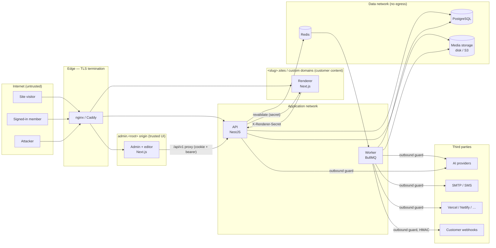
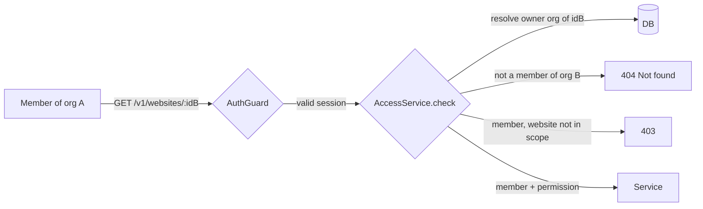
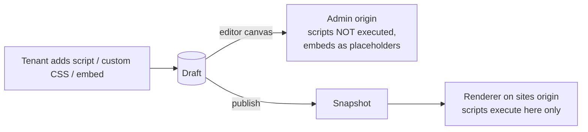
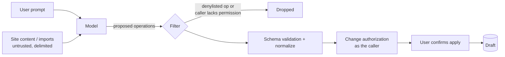

# Threat model

Atrium is a multi-tenant SaaS: many organizations build and host public websites on shared
infrastructure. This document maps the system, its trust boundaries, the assets worth attacking and
the main attack paths, with the control that addresses each. Controls are described in
[SECURITY_ARCHITECTURE.md](SECURITY_ARCHITECTURE.md); findings and fixes are in
[SECURITY_AUDIT.md](SECURITY_AUDIT.md).

## 1. System and trust boundaries

| # | Boundary | Crosses from → to | Why it matters |
|---|---|---|---|
| B1 | Internet → edge | anyone → platform | All input is hostile; TLS, size limits, rate limits. |
| B2 | Admin origin ↔ sites origin | customer site code → trusted UI | Customer scripts must never run where the session lives. |
| B3 | Browser → API | member → tenant data | Every request authenticated, then authorized per resource and tenant. |
| B4 | Tenant ↔ tenant | org A → org B | Shared tables; isolation is enforced in code on every lookup. |
| B5 | Role / website scope | editor → owner, website-scoped → org-wide | Privilege ceiling and website scoping. |
| B6 | AI model ↔ tools | model output → database writes | Model output is untrusted; tools run with the caller's permissions. |
| B7 | Renderer ↔ API | public renderer → snapshot endpoints | Shared secret; renderer sees published data only. |
| B8 | API/worker → outbound | platform → arbitrary URLs | SSRF to metadata/internal services. |
| B9 | App → data stores | services → Postgres/Redis/S3 | Least-privilege DB role, private network, no public ports. |
| B10 | CI/CD → production | repository → images/credentials | Supply chain, secrets in CI. |

## 2. Assets

| Asset | Where | Impact if compromised |
|---|---|---|
| Customer site content and drafts | `pages`, `website_settings`, `themes`, versions | Defacement, data loss, SEO poisoning. |
| Form submissions (PII) | `form_submissions`, files in storage | Personal-data breach. |
| Accounts and sessions | `users`, `sessions`, refresh cookie | Account takeover, tenant takeover. |
| Super-admin capability | `users.is_super_admin` | Full platform compromise. |
| Provider credentials | `platform_providers`, `integrations`, `*_providers` (encrypted) | Abuse of customer AI, SMTP, SMS, deploy accounts. |
| Platform secrets | `.env`: JWT, `ENCRYPTION_KEY`, `RENDERER_SECRET`, DB/Redis passwords | Forged sessions, decrypted credentials, snapshot access. |
| Media files | disk / S3 | Malware hosting, XSS via uploads, data leakage. |
| Custom domains / TLS | `domains`, ACME | Domain hijack, phishing on customer domains. |

## 3. Actors

| Actor | Capability | Goal |
|---|---|---|
| Anonymous visitor / bot | Public sites, public endpoints | Spam, scraping, DoS, exploit public endpoints. |
| Registered user without org | Signed-in, no membership | Reach any tenant data; create orgs (blocked). |
| Low-privilege member | Viewer, editor, Website Manager | Escalate role, reach other websites, inject code. |
| Malicious tenant owner | Full control of own org | Attack other tenants, the platform or site visitors (phishing, XSS on admin). |
| Prompt injector | Text inside site content, imports, form data | Make the AI agent perform privileged actions. |
| Compromised dependency / CI | Build pipeline | Exfiltrate secrets, backdoor images. |
| Network attacker | Path between services | Read or modify traffic, reach internal services. |

## 4. Major attack paths and mitigations

### 4.1 Cross-tenant access (IDOR / BOLA)

- Every resource route declares `@Access(permission, resource, param)`. The guard resolves the
  resource to its organization and website **from the database**, never from the request, and
  then checks membership, permission and website scope. Unknown or foreign resources return 404,
  so ids from other tenants are indistinguishable from missing ones.
- A route inventory test fails CI when a new route has neither `@Access`, `@Public` nor an
  explicit check (default deny).

### 4.2 Privilege escalation inside an organization

- Role editing and assignment are capped by a **privilege ceiling**: you can only grant
  permissions you hold; only owners manage owners; the last owner cannot be removed.
- Draft saves are authorized **by the diff**: adding a script, custom CSS or embed needs
  `code.manage`, changing the theme needs `theme.update`, publishing or scheduling needs
  `page.publish`, and so on. Changing text cannot smuggle a script.
- Website-scoped members (Website Manager) reach organization-level routes only for
  `organization.read`, `website.read`, `media.read/upload` and `ai.use`. Shared, org-level resources
  are read-only to them; members, usage, billing, settings and providers are denied.
- Organizations are created only by super admins; sign-up never creates one.

### 4.3 Account takeover

- Passwords use argon2id; login is locked per account after repeated failures, with constant-time
  verification for unknown accounts.
- MFA (TOTP) has attempt limits and replay protection. Super-admin pages require an MFA-verified
  session in production. Changing MFA needs a recent sign-in or the current password.
- Refresh tokens rotate on every use; reusing an old one revokes the whole session family.
- Password-reset links are single-use and expire; resets sign the user out everywhere.
- JWTs are pinned to HS256 with fixed issuer and audience.

### 4.4 Customer code reaching the trusted admin (stored XSS)

- Site scripts run only on the sites origin (`*.sites.<root>` or the customer's domain), never on
  `admin.<root>`, which holds the session. The editor does not execute site scripts and shows
  embeds as placeholders.
- Style values, theme tokens and custom CSS are validated and sanitized; the `<style>` block is
  escaped so a value cannot close it. Rich text is sanitized; template interpolation escapes HTML.
- Uploads are sniffed from their bytes, SVGs pass an allowlist sanitizer, and user files are
  served from the API/media origin with a sandboxing CSP, never from the admin origin.
- The admin sends a strict CSP and frame protections.

### 4.5 AI prompt injection and tool abuse

- The model never gets more authority than the person using it: its output is a list of editor
  operations, filtered by an operation denylist and by the caller's permissions, validated, then
  authorized by the same diff rules as manual edits. Applying requires explicit confirmation.
- Untrusted content in the context is delimited as data. AI usage is metered with atomic quota
  reservations and per-user concurrency limits.

### 4.6 SSRF

- Outbound calls (webhooks, providers, SMTP, AI base URLs, deploy hooks) go through one outbound
  guard. It resolves DNS once and pins the connection to that address, blocks private, loopback,
  link-local and metadata ranges (`169.254.169.254`), and blocks redirects to them.
- Changing the host of a stored credential requires re-entering the secret, so a saved key cannot
  be pointed at an attacker's server.

### 4.7 Public endpoints and abuse

- Form submissions: throttled per IP, honeypot and optional captcha, size limits, file types
  sniffed, spam scoring; notification emails escape user input; CSV exports neutralize formulas.
- Snapshot and preview endpoints require `X-Renderer-Secret`; preview tokens are random and expire.
- Custom domains are served only after DNS TXT proof; on-demand TLS asks the API first.

### 4.8 Infrastructure and supply chain

- Containers run read-only, without Linux capabilities, as non-root; the data network has no
  egress; the app connects with a DML-only database role.
- Production refuses to start with missing, weak or placeholder secrets.
- CI runs a dependency audit, gitleaks secret scan, CodeQL, a Trivy IaC scan and the security test
  suite; Renovate updates are grouped and not auto-merged (see
  [DEPENDENCY_POLICY.md](DEPENDENCY_POLICY.md)).

## 5. Residual risks

See "Remaining risks" in [SECURITY_AUDIT.md](SECURITY_AUDIT.md). The main ones are operational:
secret rotation, backups and restore drills, monitoring and alerting, and TLS/DNS setup that has to
be verified in a real production environment.
